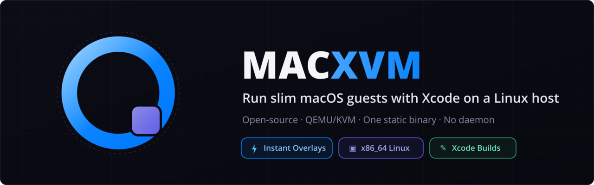
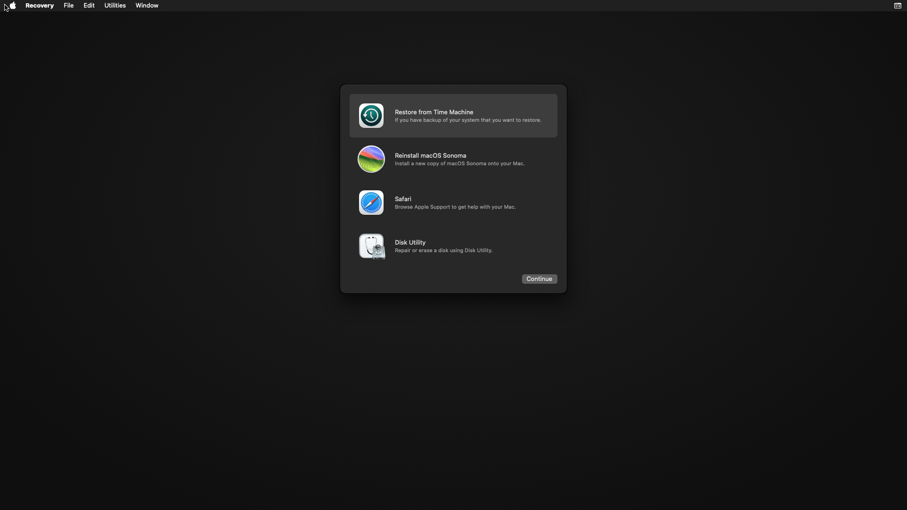
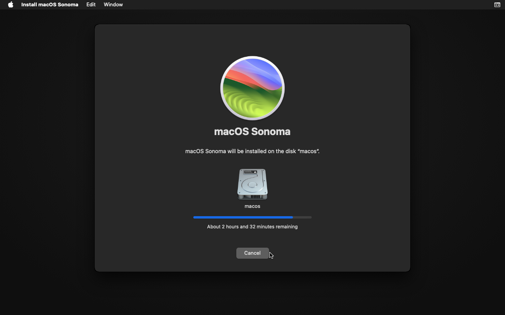
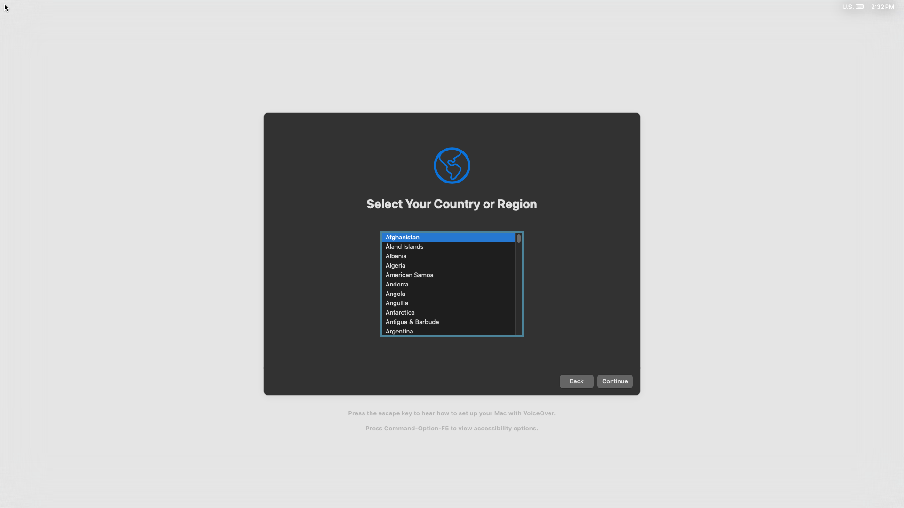
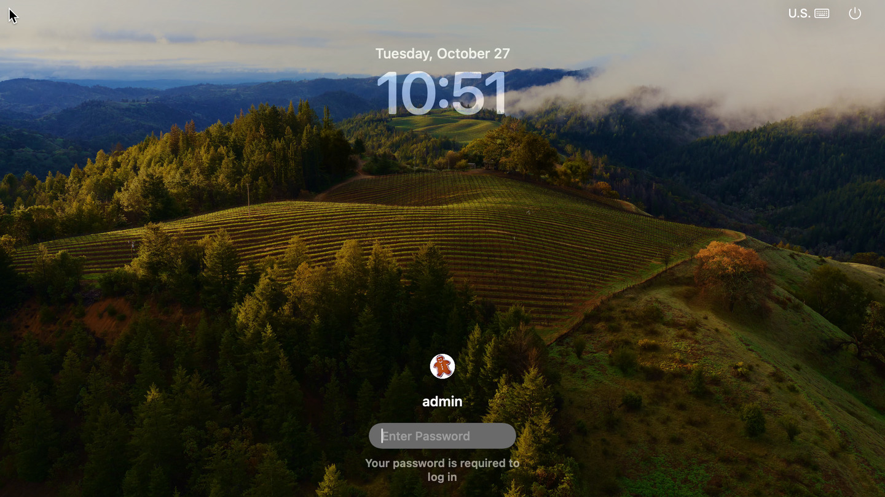

<a id="credits"></a>
# Credits

MacXVM stands on the shoulders of the people who made running macOS on QEMU possible in the first place. It ships no Apple software, no firmware, no boot loader and no keys, and it launches only what you provide.

- **[OSX-KVM](https://github.com/kholia/OSX-KVM)** by *kholia*: the original guide and boot script for running macOS on QEMU/KVM, and the reference for the machine definition that the args file adapts.
- **[ultimate-macOS-KVM](https://github.com/Coopydood/ultimate-macOS-KVM)** by *Coopydood*: the maintained guide that turns the boot script into a complete, reproducible installation.
- **[QEMU](https://www.qemu.org)**: the emulator that runs the guest.
- **[OpenCore](https://github.com/acidanthera/OpenCorePkg)**: the boot loader used by those guides, installed and configured by you.
- **[Apple](https://www.apple.com)**: macOS, Xcode and iOS, which are trademarks of Apple Inc. and are neither distributed nor endorsed by this project.

MacXVM is an independent open-source project, not affiliated with or endorsed by Apple Inc.

---

<div align="center">

<a href="https://github.com/shadow-x78/macxvm">
  
</a>

# MacXVM

Run slim macOS guests with Xcode on a Linux host.

[](CHANGELOG.md)
[](LICENSE)


</div>

---

## Language

<a href="README.md">🇬🇧 English</a> · <a href="README_AR.md">🇸🇦 العربية</a>

---

## Table of Contents

- [What this is](#what)
- [Before you start](#before)
- [Install it](#install)
- [Run your first machine](#first-machine)
- [The commands you will actually use](#everyday)
- [How it works](#how)
- [The args file](#args-file)
- [Machine profiles](#profiles)
- [Speed](#speed)
- [Screenshots](#screenshots)
- [Legal and limits](#legal)
- [Troubleshooting](#troubleshooting)
- [Documentation](#documentation)
- [Project structure](#structure)
- [Contributing](#contributing)
- [License](#license)

---

<a id="what"></a>
## What this is

MacXVM is one command that runs a macOS virtual machine on a Linux computer, and then builds your Apple projects inside it.

You give it a Linux host with hardware virtualisation. It creates a macOS guest, starts it under QEMU/KVM, opens a screen when you ask for one, and lets you run `xcodebuild`, `swift build`, `brew` and any other command inside that guest from your Linux terminal.

```bash
macxvm exec macos -- swift --version          # run a command inside the guest
macxvm build --project . --scheme App         # build the project in the project directory
```

It is a single static binary of about 8.5 MB. There is no daemon, no service and no background process: QEMU runs only while a machine is started.

> **Read [Legal and limits](#legal) before you install.** Running macOS on hardware that Apple did not make is a licence problem, not a technical one. MacXVM ships none of Apple's software; you supply it, and you are responsible for how you use it.

<a id="before"></a>
## Before you start

You need four things. `macxvm doctor` checks all of them and tells you what is missing.

| You need | Why | Check with |
|---|---|---|
| A Linux x86_64 host with VT-x or AMD-V | the guest runs on the processor of the host | `lscpu \| grep -i virtual` |
| `/dev/kvm` that your user may open | without it QEMU emulates the processor and the guest is unusably slow | `ls -l /dev/kvm` |
| QEMU 6.0 or newer | `qemu-system-x86_64` and `qemu-img` are the engine | `qemu-system-x86_64 --version` |
| About 40 GB of free disk | the macOS installer is about 1 GB, the guest disk 64 GB, and the rest is scratch | `df -h ~` |

```bash
macxvm doctor
```

Every line is `[ok]` or `[warn]`, and a warning tells you the exact command that fixes it. If a check fails, stop here and fix it: nothing else in this guide works without `/dev/kvm` and QEMU.

<a id="install"></a>
## Install it

You need Go 1.22 or newer, only to build the binary. There is no package yet.

```bash
git clone https://github.com/shadow-x78/macxvm.git ~/MacXVM
cd ~/MacXVM

./scripts/install.sh          # builds and copies macxvm to ~/.local/bin
export PATH="$HOME/.local/bin:$PATH"
macxvm version                # macxvm 0.10.3
```

If `~/.local/bin` is not in your `PATH`, add that `export` line to your `~/.zshrc` or `~/.bashrc`, otherwise the next terminal will not find the command.

Prefer to keep it in the repository? `make build` leaves the binary at `./bin/macxvm`.

<a id="first-machine"></a>
## Run your first machine

This is the whole flow, in order. It takes about an hour, most of it waiting for Apple's installer.

```bash
# 1. Download the boot files and create the machine (about 1 GB of downloads).
macxvm image prepare macos --profile cli

# 2. Install macOS without touching the screen, until the first Setup page.
macxvm autoinstall macos --yes --accept-license
```

Step 2 drives the macOS Recovery installer for you: it erases the matching disk, accepts the licence when you pass `--accept-license`, installs, reboots, and **stops at the first Setup Assistant page**. It never creates an account and never stores a password. Expect 40 to 90 minutes; `--timeout MINUTES` raises the default limit of 240 minutes.

```bash
# 3. Finish Setup Assistant yourself, in the screen window.
macxvm open macos
```

In that window, choose your country, create the local administrator account (**the user name must be `admin`**, which is the default), skip the Apple ID if you do not want one, and then turn on **System Settings › General › Sharing › Remote Login**. This step is manual on purpose: those screens belong to you, not to the tool.

```bash
# 4. Hand the machine back to MacXVM. It asks for the password you just set.
macxvm finish macos --password-stdin --apps
```

Type the password and press Enter; the input is hidden, and the password is never written to a file or to a log. This step installs the SSH key and sudo, sets Dark mode and disables sleep, trims the machine, switches it to the supported display, and removes the applications you agreed to remove.

```bash
# 5. Use it.
macxvm start macos --vnc --wait
macxvm exec macos -- sw_vers
```

If everything worked, `sw_vers` prints the macOS version from inside the guest. You now have a working macOS machine, and the rest of this page is reference.

<details>
<summary><b>Nothing appeared on screen, or the installer did not start</b></summary>
<br>

- `macxvm open macos` needs the machine to be running with VNC. If it says it is running headless, run `macxvm open macos --restart`.
- A VNC viewer is required: `vncviewer`, `gvncviewer` or `remmina`. Without one, the tool prints the `127.0.0.1:59xx` address so you can open it yourself.
- `autoinstall` refuses to run when the machine is already past the fresh-install stage. That is a safety check: it will not erase an installation.
- Every error is written to stderr with a message that names the next command. Read it before retrying.

</details>

<a id="everyday"></a>
## The commands you will actually use

| You want to | Run |
|---|---|
| see your machines | `macxvm list` |
| start one, with a screen | `macxvm start NAME --vnc --wait` |
| get a shell inside | `macxvm ssh NAME` |
| run one command inside | `macxvm exec NAME -- CMD ...` |
| copy a file in or out | `macxvm cp ./file NAME:/Users/admin/file` |
| build an Xcode project | `macxvm build --project . --scheme App` |
| share a folder both ways | `macxvm share add NAME --host ~/code/proj` then `macxvm share sync NAME` |
| make the guest lighter | `macxvm slim NAME --level 1` |
| stop it | `macxvm stop NAME` |
| delete it | `macxvm delete NAME --yes` |

The complete list, flag by flag, is in [Command reference](docs/COMMANDS.md).

### Using one machine as a template

Once a machine works, you can seal it and create copies that cost a second and a few hundred kilobytes instead of a full disk copy.

```bash
macxvm stop macos
macxvm base seal macos        # mark it as a sealed base
macxvm create dev --base macos
macxvm start dev --vnc --wait
```

A sealed base is never modified; each copy gets its own disk overlay and its own NVRAM. For a throwaway machine that disappears after one command:

```bash
macxvm run --from macos -- sh -c 'swift --version'
```

<a id="how"></a>
## How it works

```
your terminal  ->  macxvm  ->  QEMU/KVM process  ->  macOS guest
                      |                                  |
                      +---------- ssh, scp, rsync --------+
```

- The **state directory** is `~/.local/share/macxvm` (or `$MACXVM_HOME`, or `$XDG_DATA_HOME/macxvm`). It holds one directory per machine, the boot assets, and the SSH key the tool generates.
- Each machine is a **directory**, not a database: `config.json`, `disk.qcow2`, `nvram.fd`, the args file, and the logs. You can copy it, inspect it, or delete it.
- The tool talks to the guest only over **SSH to `127.0.0.1:<port>`**, never over a special protocol. Anything you can do with `ssh` you can still do by hand.
- There is **no daemon**. `start` spawns QEMU and records its PID and a QMP socket; `status` reads them; `stop` asks the guest to shut down and only then escalates.

<a id="args-file"></a>
### The args file

MacXVM does not hard-code a machine definition. It reads a QEMU command line that you provide, substitutes a few placeholders, and runs the result. The default template is in `resources/args-template.txt`; `macxvm image prepare` writes one for you.

```bash
qemu-system-x86_64 \
  -accel kvm \
  -cpu host \
  -smp {{CPUS}} \
  -m {{RAM_MIB}} \
  -drive file={{DISK_IMG}},format=qcow2,{{DISK_OPTS}} \
  -netdev {{NETDEV}} \
  -device virtio-net-pci,netdev=net0,mac={{MAC}}
```

| Placeholder | Value |
|-------------|-------|
| `{{CPUS}}` | the number of CPUs |
| `{{CORES}}` | half of the CPUs, at least one |
| `{{RAM_MIB}}` | the memory in MiB |
| `{{DISK_IMG}}` | the absolute path of the disk |
| `{{DISK_OPTS}}` | `cache=writeback`, or `cache=unsafe` for a throwaway machine |
| `{{NVRAM}}` | the NVRAM file, when the machine has one |
| `{{ASSETS}}` | the boot assets directory |
| `{{MAC}}` | the MAC address of the machine |
| `{{NETDEV}}` | the SSH port forward |

MacXVM adds `-name`, `-pidfile`, `-qmp`, `-display` and `-vnc` itself, so the file must not contain them. Delete `-monitor stdio` from scripts you copy from elsewhere. The full rules, including how to adapt an existing boot script, are in [docs/ARGS_FILE.md](docs/ARGS_FILE.md).

<a id="profiles"></a>
## Machine profiles

| Profile | CPUs | RAM | Disk | Use it for |
|---|---|---|---|---|
| `cli` (default) | 6 | 12 GiB | 64 GiB | Swift packages, Homebrew, scripts, and Xcode if you install it |
| `xcode` | 4 | 8 GiB | 100 GiB | large Xcode installs and simulators |

These are logical device sizes, not promises about free space inside APFS or about the smoothness of the graphical desktop. Change them with `--cpus`, `--ram` and `--disk` when you create a machine, or with `macxvm resize` while it is stopped.

<a id="speed"></a>
## Speed

| Operation | Measured on the machine that builds this project |
|---|---|
| `list`, `status` | 3 ms |
| Release binary | 7,213,208 bytes with Go 1.22, static `linux/amd64` |
| Clone of a sealed base | under 1 s, a few hundred KiB on disk |
| Idle cost on the host | no process of MacXVM stays alive |

A boot time depends on your args file and on your disk; run `scripts/bench.sh BASE` to measure your own host. The guest gets the same speed the host allows because the args file enables `-accel kvm`, the host CPU model, AHCI disks (macOS has no virtio disk driver), and the Bochs display that macOS drives with `AppleBochVGAFB`.

<a id="screenshots"></a>
## Screenshots

These are examples from a real run, not a promise that every stage looks the same on your host.






<a id="legal"></a>
## Legal and limits

> MacXVM is an independent open-source project, not affiliated with or endorsed by Apple Inc. macOS, Xcode and iOS are trademarks of Apple Inc. This project distributes no Apple software; you supply it, and you are responsible for complying with Apple's licence.

1. **Apple's licence allows macOS in a virtual machine only on Apple-branded hardware.** Running it under QEMU/KVM on a PC breaks that licence, and Apple has enforced it in court. MacXVM is a launcher: it ships no Apple software, firmware, keys or boot loader and starts only what you provide. The compliant alternatives are a Mac, or a Mac rented in the cloud.
2. **x86_64 only.** Apple supports Intel Macs up to macOS 26, so the guest is limited to macOS ≤ 26 and to the Xcode versions that run on it. Choose the two together from Apple's Xcode release notes; this project hard-codes no version pair.
3. **No Metal and no 3D acceleration.** The supported display is a Bochs framebuffer driven by `AppleBochVGAFB`. It is a real macOS driver, but it is 2D only: the iOS Simulator and Metal applications stay slow. NVIDIA passthrough is not a supported macOS path.
4. **Do not update macOS inside the guest.** A system update can break booting. Slim level 1 disables automatic updates for that reason.
5. **You supply the boot assets.** The machine definition, the boot loader, the firmware and the installer image come from you. `macxvm image link` prints where they come from and `macxvm image prepare` fetches them into your own state directory; nothing of Apple is stored in this repository or in a release.

<a id="troubleshooting"></a>
## Troubleshooting

| Symptom | Cause | Fix |
|---|---|---|
| `macxvm: /dev/kvm is not readable` | your user is not in the `kvm` group | `sudo usermod -aG kvm $USER`, then log out and back in |
| The guest is extremely slow | QEMU did not pick KVM | add `-accel kvm` to the args file; `macxvm doctor` reports this |
| The screen stays black | the guest has no display, or the viewer is missing | `macxvm open macos --restart` |
| `the destination has no migration plan` | a migration was cancelled before the plan arrived | rerun `macxvm migrate NAME --to USER@HOST --check` |
| `autoinstall` refuses to run | the machine is past the fresh-install stage | it will not erase an installation; create a new machine instead |
| `permission denied (publickey)` over SSH | Remote Login is off in the guest | turn it on in the guest, then `macxvm ssh-key --install NAME` |

More, with the exact output of each command, is in [docs/TROUBLESHOOTING.md](docs/TROUBLESHOOTING.md).

<a id="documentation"></a>
## Documentation

| Document | What it answers |
|---|---|
| [INSTALLATION.md](docs/INSTALLATION.md) | requirements, the build, the state directory, how to remove everything |
| [COMMANDS.md](docs/COMMANDS.md) | every command and every flag |
| [BUILDING.md](docs/BUILDING.md) | the project file, the build flow, ephemeral builds |
| [ARGS_FILE.md](docs/ARGS_FILE.md) | the machine definition in detail |
| [GPU.md](docs/GPU.md) | the display, the real macOS kext, passthrough limits |
| [SLIM.md](docs/SLIM.md) | what each slimming level changes, and how to undo it |
| [ARCHITECTURE.md](docs/ARCHITECTURE.md) | the packages, the lifecycle, the state layout |
| [TROUBLESHOOTING.md](docs/TROUBLESHOOTING.md) | the common failures and their exact fixes |
| [DECISIONS.md](docs/DECISIONS.md) | every deliberate deviation and why it exists |

Every document exists in English and in Arabic, and the [Arabic README](README_AR.md) mirrors this page.

<a id="structure"></a>
## Project structure

```
macxvm/
├── cmd/macxvm/        the entry point
├── internal/          one package per area (config, store, qemu, sshx, cmds, ...)
├── resources/         the args templates and the guest scripts
├── scripts/           install, benchmark, style checks
├── docs/              the guides, in English and Arabic
├── driver/            the MXGPU kernel extension package (experimental)
├── assets/            the logo and the screenshots
└── Makefile           build, test, install, clean
```

The detailed map is in [ARCHITECTURE.md](docs/ARCHITECTURE.md).

<a id="contributing"></a>
## Contributing

1. Fork the repository and create a branch: `feature/`, `fix/`, `docs/` or `chore/`.
2. Keep `go vet ./...`, `go test ./...` and `make build` green, and keep the file headers and the formatting intact.
3. Add an entry to `CHANGELOG.md`.
4. Commit as `macxvm | vX.Y.Z | type: description` and open a pull request against `main`.

Read [CONTRIBUTING.md](CONTRIBUTING.md) and [CODE_OF_CONDUCT.md](CODE_OF_CONDUCT.md). Report problems through [GitHub Issues](https://github.com/shadow-x78/macxvm/issues).

<a id="license"></a>
## License

Distributed under the [MIT License](LICENSE).

---

<div align="center">

Built by <a href="https://github.com/shadow-x78">shadow-x78</a> ·
[Changelog](CHANGELOG.md) ·
[Security](SECURITY.md)

<sub>&copy; 2026 MacXVM</sub>

</div>
