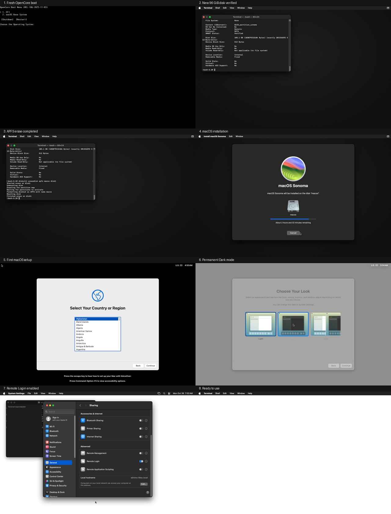
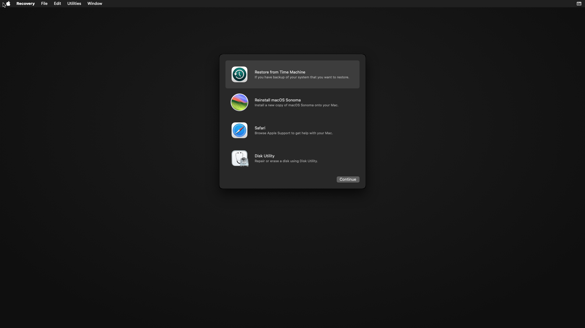
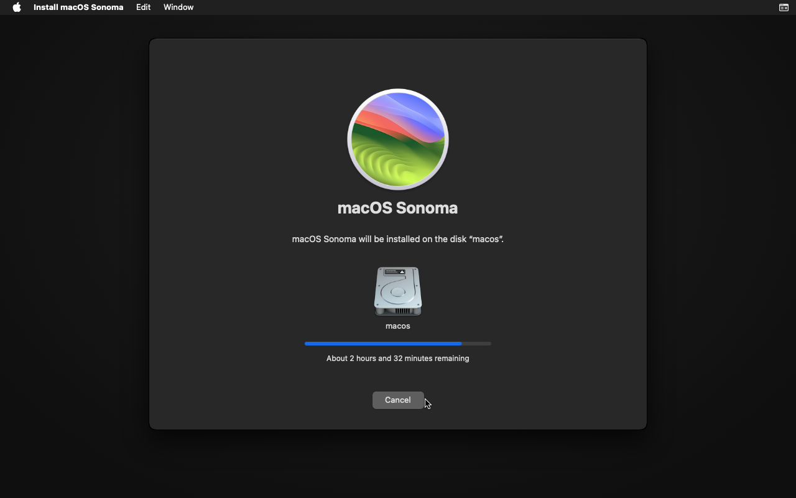
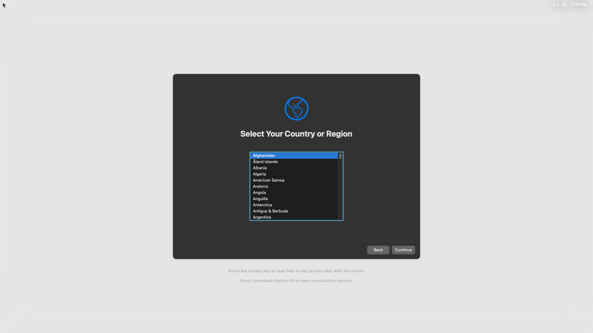
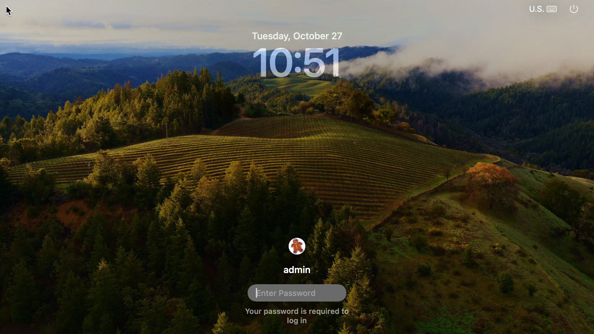
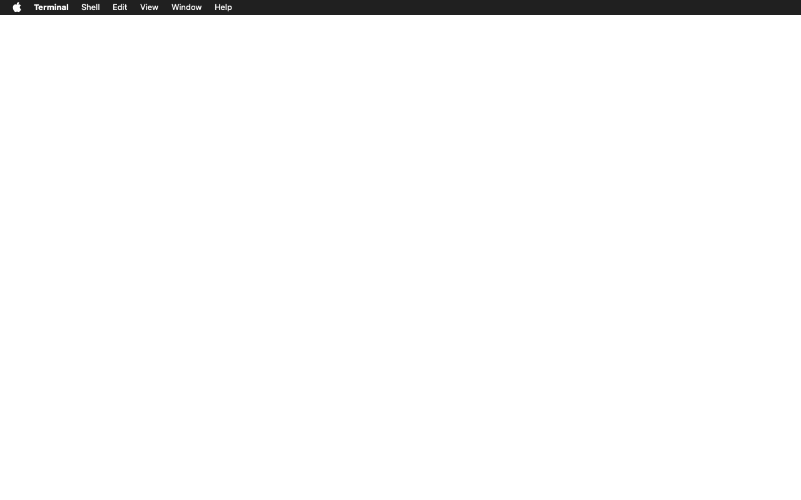
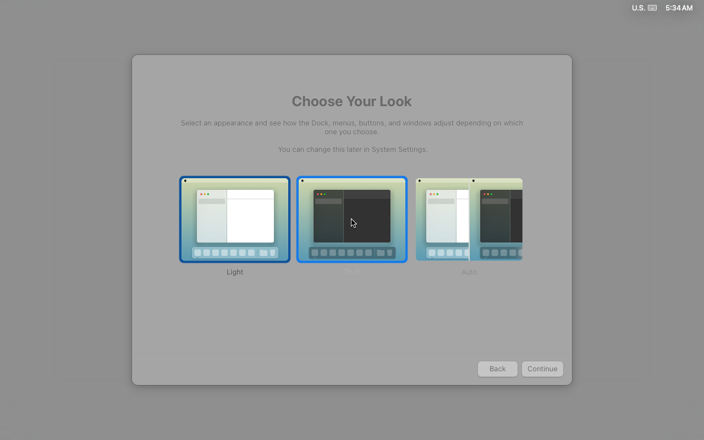
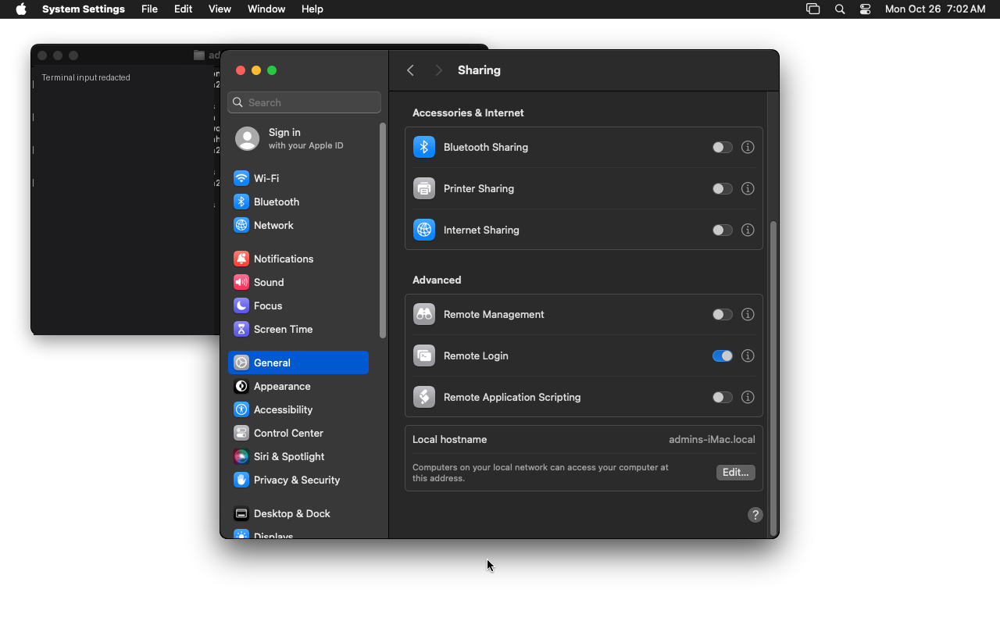

<a id="credits"></a>
# Credits

MacXVM stands on the shoulders of the people who made running macOS on QEMU possible in the first place. It ships no Apple software, no firmware, no boot loader and no keys, and it launches only what you provide.

- **[OSX-KVM](https://github.com/kholia/OSX-KVM)** by *kholia*: the original guide and boot script for running macOS on QEMU/KVM, and the reference for the machine definition that the args file adapts.
- **[ultimate-macOS-KVM](https://github.com/Coopydood/ultimate-macOS-KVM)** by *Coopydood*: the maintained guide that turns the boot script into a complete, reproducible installation.
- **[QEMU](https://www.qemu.org)**: the emulator that runs the guest.
- **[OpenCore](https://github.com/acidanthera/OpenCorePkg)**: the boot loader used by those guides, installed and configured by you.
- **[Apple](https://www.apple.com)**: macOS, Xcode and iOS, which are trademarks of Apple Inc. and are neither distributed nor endorsed by this project.

MacXVM is an independent open-source project, not affiliated with or endorsed by Apple Inc.

---

<div align="center">

<a href="https://github.com/shadow-x78/macxvm">
  
</a>

# MacXVM

Run slim macOS guests with Xcode on a Linux host.

[](CHANGELOG.md)
[](LICENSE)


</div>

---

## Language

<a href="README.md">🇬🇧 English</a> · <a href="README_AR.md">🇸🇦 العربية</a>

---

## Table of Contents

- [Overview](#overview)
- [Legal and limits](#legal)
- [Requirements](#requirements)
- [Installation](#installation)
- [Features](#features)
- [The args file](#args-file)
- [Quick start](#quick-start)
- [Screenshots](#screenshots)
- [Sharing a folder](#sharing)
- [Profiles](#profiles)
- [Slimming](#slimming)
- [Building projects](#building)
- [Command reference](#commands)
- [Speed](#speed)
- [Project structure](#project-structure)
- [Documentation](#documentation)
- [Contributing](#contributing)
- [License](#license)

---

<a id="overview"></a>
## Overview

MacXVM turns a Linux machine into a build farm for macOS. It registers macOS guests, starts them under QEMU/KVM, trims them down so that they idle quietly, installs Xcode inside them and builds your projects from Linux with `rsync` and `ssh`.

The tool is a single static binary of about 7.6 MB with no daemon. QEMU itself is the only long-lived process, so an idle host carries nothing at all.

```
macxvm image prepare macos --profile cli
macxvm autoinstall macos --yes --accept-license
macxvm finish macos --password-stdin --apps
macxvm start macos --vnc --wait
macxvm exec macos -- sh -c 'echo ready'
```

A sealed base image plus qcow2 overlays is what makes this fast: a fresh machine costs a few hundred kilobytes and a second, not a copy of a hundred gigabytes. Overlays disappear with `macxvm run`, which starts a throwaway machine, runs one command in it and removes it again.

MacXVM never describes a macOS machine itself. The machine definition lives in an args file that you write, MacXVM substitutes a few placeholders into it and starts QEMU with the result.

<a id="legal"></a>
## Legal and Limits

> MacXVM is an independent open-source project, not affiliated with or endorsed by Apple Inc. macOS, Xcode and iOS are trademarks of Apple Inc. MacXVM does not distribute any Apple software; the user supplies and is responsible for all Apple software and for complying with Apple's license terms.

Read this before you install anything:

1. **Apple's macOS license permits macOS in a virtual machine only on Apple-branded hardware.** Running macOS under QEMU/KVM on a PC violates that license, and Apple has enforced it in court. MacXVM is a *launcher*: it ships no Apple software, firmware, keys or boot loaders and only starts what you provide. **You are responsible for compliance.** The compliant alternatives are a Mac (use the Apple-hardware specification) or a rented Mac in the cloud.
2. **x86_64 only.** The guest is an x86_64 macOS. Apple supports Intel Macs up to macOS 26, so the guest is limited to macOS ≤ 26 and therefore to the Xcode versions that run on it. Pick the macOS version and the Xcode version together, using the release notes of Xcode. This project never hardcodes version pairs.
3. **Host.** Linux x86_64 with hardware virtualisation (Intel VT-x or AMD-V), a `/dev/kvm` that your user may use, and QEMU 6.0 or newer. ARM Linux hosts are not supported.
4. **No Metal or 3D acceleration.** The supported path is a Bochs framebuffer (`AppleBochVGAFB`) at 1920x1080 (QEMU reserves a 256 MB device aperture; macOS reports 7 MB VRAM). It is a real macOS display driver, but it is 2D only: the iOS Simulator and Metal apps stay slow. NVIDIA RTX passthrough is not a macOS-supported path and is unavailable on this host (no IOMMU groups, and macOS has no RTX 5060 driver).
5. **Fragility.** A macOS system update inside such a virtual machine can break booting. The slim level 1 switches the automatic updates off, and you should not run system updates in the guest.
6. **The boot assets are your job.** The machine definition, the bootloader, the firmware files and the macOS installer image come from you, for example by following the documentation of the open-source projects listed in the [credits](#credits). MacXVM copies none of their content.
7. **No Apple software is ever stored in this repository or in a release of it.** `macxvm image link` prints the addresses of the boot assets, and `macxvm image prepare` fetches them into the state directory of MacXVM on your own machine, when you ask for it. The installer of Apple comes from the recovery service of Apple and is checked against the signature of Apple before it is used. Nothing of Apple is committed, tagged or uploaded, so the repository holds no content of Apple and cannot be taken down for it.

<a id="requirements"></a>
## Requirements

| Requirement | Detail |
|-------------|--------|
| Host | Linux x86_64, hardware virtualisation, `/dev/kvm` usable by your user |
| QEMU | `qemu-system-x86_64` and `qemu-img`, version 6.0 or newer |
| Host tools | `ssh`, `scp`, `rsync`, `ssh-keygen`, `python3` (screenshots) |
| Automation | `tesseract`, `vncdo`, `genisoimage` or `mkisofs` (for `autoinstall`) |
| Guest | x86_64 macOS ≤ 26, installed by you, with Remote Login enabled |
| Go | 1.22 or newer, only to build MacXVM |

Check everything with:

```bash
macxvm doctor
```

The doctor also tells you when QEMU does not pick the KVM accelerator on its own. Some builds only use
KVM when it is named, and a machine that asks for the host CPU needs it. Add `-accel kvm` to the args file
of the machine in that case:

```bash
qemu-system-x86_64 \
  -accel kvm \
  -cpu host \
  ...
```

<a id="installation"></a>
## Installation

**From source:**

```bash
git clone https://github.com/shadow-x78/macxvm.git ~/MacXVM
cd ~/MacXVM && ./scripts/install.sh
```

**With the Makefile:**

```bash
git clone https://github.com/shadow-x78/macxvm.git && cd macxvm
make build
make install          # installs ~/.local/bin/macxvm
```

The binary is about 4 MB, static and built for `linux/amd64`. It needs no daemon and no service.
The full guide, including the state directory and the removal, is in [docs/INSTALLATION.md](docs/INSTALLATION.md).

<a id="features"></a>
## Features

- Registers, starts, stops, clones and deletes macOS guests under QEMU/KVM
- A reviewed default args template in `resources/args-template.txt`, or your own args file, as the machine definition: the macOS-on-QEMU values are data, not Go source
- Sealed base images with qcow2 overlays: a fresh machine costs a few hundred kilobytes and a second
- Throwaway machines with `macxvm run`: the overlay is removed afterwards, even when the command is interrupted
- Three slimming levels plus a separate selective `apps` engine, with a deny list that protects SSH and the network; level 3 never bulk-deletes caches, logs, mail or simulator data
- The Command Line Tools, Homebrew and Xcode installed inside the guest from the host
- `xcodebuild` and `swift build` on a remote guest, with the derived data kept between the builds
- A project file that holds the defaults of a build, a machine and a base image
- Headless by default, a VNC display on the loopback interface when you need to see the screen
- One static binary of about 4 MB, the Go standard library only, no third-party modules, no daemon, no background process

<a id="args-file"></a>
## The Args File

The args file is the machine definition you bring. MacXVM substitutes a few placeholders and adds the flags it needs to manage the machine.

```bash
qemu-system-x86_64 \
  -accel kvm \
  -cpu host \
  -smp {{CPUS}} \
  -m {{RAM_MIB}} \
  -drive file={{DISK_IMG}},format=qcow2,{{DISK_OPTS}} \
  -drive file={{ASSETS}}/efi.img,format=raw \
  -netdev {{NETDEV}} \
  -device virtio-net-pci,netdev=net0,mac={{MAC}}

#install -drive file={{ASSETS}}/installer.img,format=raw
```

| Placeholder | Value |
|-------------|-------|
| `{{CPUS}}` | the number of CPUs of the machine |
| `{{CORES}}` | half of the CPUs, at least one |
| `{{RAM_MIB}}` | the memory of the machine in MiB |
| `{{DISK_IMG}}` | the absolute path of the disk of the machine |
| `{{DISK_OPTS}}` | `cache=writeback`, or `cache=unsafe` for a throwaway machine |
| `{{NVRAM}}` | the absolute path of the NVRAM file, only when the machine has one |
| `{{ASSETS}}` | the assets directory of the machine |
| `{{MAC}}` | the MAC address of the machine |
| `{{NETDEV}}` | `user,id=net0,hostfwd=tcp:127.0.0.1:<port>-:22` |

`{{DISK_IMG}}`, `{{NETDEV}}`, `{{MAC}}`, `{{RAM_MIB}}` and `{{CPUS}}` are required. MacXVM injects `-name`, `-pidfile`, `-qmp`, `-display` and `-vnc` itself, so the args file must not contain them. Most boot scripts of other projects use `-monitor stdio`, delete that line.

The full guide, including how to adapt an upstream boot script, is in [docs/ARGS_FILE.md](docs/ARGS_FILE.md).

<a id="quick-start"></a>
## Quick Start

The default workflow uses the `cli` profile: 4 vCPUs, 8192 MiB RAM and a 64 GiB logical qcow2 disk. These are logical device sizes, not promises about APFS free space or the speed of a graphical guest. There is one default VM; the `xcode` profile remains available only when you explicitly ask for it.

```bash
# 1. Fetch and verify versioned assets, then create the single default VM.
macxvm image prepare macos --profile cli

# 2. Fully automated installation: OpenCore, Recovery, Terminal, disk erase,
#    license (only with the explicit flag), target disk and Install.
#    It stops at the FIRST Setup Assistant page, before any user account.
macxvm autoinstall macos --yes --accept-license

# 3. Finish Setup Assistant yourself in VNC: country, account, Remote Login.
#    Then resume the rest without reinstalling anything:
macxvm finish macos --password-stdin --apps

# 4. This is the single default VM. Optional: use it as a base later.
#    macxvm stop macos && macxvm base seal macos
#    macxvm create dev --base macos
macxvm start macos --vnc --wait
macxvm exec macos -- sh -c 'echo ready'
```

`autoinstall` refuses to erase an existing installation unless the VM was created by `image prepare` and is still at the fresh-install stage. It selects exactly one internal disk whose byte size matches the configured disk and refuses ambiguity. It never types or stores the account password.

`finish` installs the SSH key and sudoers through hidden/stdin password input, verifies `sudo -n`, sets Dark mode and disables sleep, applies slim level 1, switches the display to the macOS-supported Bochs framebuffer, prints an application preview, optionally removes only the allowlisted applications, verifies the guest and optionally seals the base.

### GPU and display

```bash
macxvm gpu macos          # host GPU/IOMMU plus the real macOS kext
macxvm optimize macos     # stopped VM: -vga none + bochs-display 1920x1080
```

Reverse engineering of the guest kexts shows that `AppleVirtualGraphics.kext` matches only Bochs VGA (`0x1234:0x1111`, class `AppleBochVGAFB`) and Cirrus (`0x1013:0x0000`). The default therefore uses Bochs VGA. macOS loads `AppleBochVGAFB`, the display is 1920x1080, and the guest reports a real framebuffer instead of “No Kext Loaded”. This is the fastest supported display path, but it is not Metal or 3D acceleration.

During `autoinstall` the VM temporarily uses `vmware-svga` because Recovery accepts reliable absolute pointer input with it; `finish` switches to Bochs after the manual Setup Assistant. A running VM cannot change display devices; stop it first.

The explicit `xcode` profile remains 4 vCPUs / 8192 MiB / 100 GiB. Values below the supported 4096 MiB or 64 GiB minima are experimental and need `--force`; `--force` never replaces an existing VM. Use `--replace` for a stopped replacement.

### What `macxvm image prepare` does

| Step | Source and guarantee |
|------|----------------------|
| Apple recovery | Versioned Apple recovery files; RSA signature and every chunk are checked before conversion |
| OpenCore and firmware | Pinned OSX-KVM references with SHA-256 verification |
| Assets | `assets/<macos>/<revision>/manifest.json`, size/hash/source records; interrupted files are `.partial`, never final |
| Disk | GPT in a sparse staging raw file, one conversion to qcow2, `qemu-img check`, atomic rename |
| NVRAM | A copy of the template per VM; the shared template is never opened writable |

Versioned caches are reused only after manifest verification. Unversioned legacy Apple images are not imported into another macOS version. The supported macOS names are `high-sierra`, `mojave`, `catalina`, `big-sur`, `monterey`, `ventura`, `sonoma`, `sequoia` and `tahoe`.

<a id="screenshots"></a>
## Screenshots

The checked-in screenshots are examples, not a claim that every stage has been
revalidated on this host. Capture fresh evidence with `scripts/screenshot.sh
NAME assets/screenshots/FILE.png` after checking the VM state.

**Guest overview**



**macOS Recovery boot of the default VM**



**Installation progress**



**Automated installation stops at the first Setup Assistant screen**



**Bochs display with AppleBochVGAFB loaded (login window)**



**Dark desktop and Remote Login**





> The installer must erase the matching internal QEMU disk as APFS before a
> target volume appears. Identify it by controller, size and content; never
> assume a fixed `/dev/diskN` or erase an unverified disk.

<a id="first-boot-checklist"></a>
### First boot: automated, then one manual window

1. `macxvm autoinstall macos --yes --accept-license` selects and erases only the
   matching internal disk, accepts the license, installs, reboots and stops at
   the first Setup Assistant page. It never creates an account.
2. In VNC, finish Setup Assistant yourself: country, the local administrator,
   and **System Settings > General > Sharing > Remote Login**.
3. Run `macxvm finish macos --password-stdin --apps`. It installs the SSH key,
   validates sudoers with `visudo` and `sudo -n`, sets Dark mode and no sleep,
   applies slim level 1, switches to the Bochs display, writes an application
   preview and verifies the guest.
4. The system applications live on the SIP-protected system volume. They are
   reported as `protected` and are never deleted; only unprotected allowlisted
   applications can be removed. Do not disable SIP to force removal.
5. There is one default VM. Seal it only if you explicitly want a base for
   overlays:

```bash
macxvm stop macos
macxvm base seal macos
macxvm create dev --base macos
```

For an Xcode workload, install the Command Line Tools and Xcode explicitly; the
default `cli` profile does not install Xcode automatically.

<a id="profiles"></a>
## Profiles

| Profile | Contents | Default resources | Use |
|---------|----------|-------------------|-----|
| `cli` (default) | one slim macOS VM; install CLT/Xcode only when needed | 4 CPU / 8192 MiB / 64 GiB logical qcow2 | Swift packages, Homebrew, scripts, and optional Xcode |
| `xcode` | explicit alternative with a larger disk | 4 CPU / 8192 MiB / 100 GiB | large Xcode installs and simulators |

| | `cli` | `xcode` |
| :--- | :---: | :---: |
| `swift build` / `swift test` for macOS | ✅ | ✅ |
| Homebrew packages, git, scripts | ✅ | ✅ |
| `xcodebuild`, `.xcodeproj`, `.xcworkspace` | ❌ exit 9 | ✅ |
| iOS SDK and iOS Simulator | ❌ the Command Line Tools have the macOS SDK only | ✅ software rendered |

<a id="slimming"></a>
## Slimming

```bash
macxvm slim demo --level 1
macxvm slim demo --level 2 --measure
macxvm apps remove demo --set default --dry-run
macxvm apps remove demo --set default --yes
macxvm slim demo --restore
```

Level 1 sets Dark mode, disables Spotlight indexing, Time Machine, automatic updates, animations and sleep timers. Level 2 also disables only the selected launchd labels in `resources/slim-labels.txt`, with a deny list for SSH, networking, WindowServer and launchd.

Level 3 is the same allowlisted application engine as `macxvm apps`, with `dry-run`, explicit confirmation and `--keep`; use `slim --level 3 --dry-run` or `slim --level 3 --yes` for compatibility. It removes only verified, unprotected default applications and Dock entries. It never deletes accounts, Mail data, caches, logs, `/var/folders`, simulator runtimes or boot/network components. `slim --restore` restores services and update policy, not applications; clone the base to roll back removal.

The details are in [docs/SLIM.md](docs/SLIM.md).

<a id="sharing"></a>
## Sharing a Folder

A folder of the host can be kept in step with a folder of the guest. The tool
copies both ways with `rsync` over the SSH of the machine, so nothing new runs
on the host and no service of the guest is needed.

```bash
macxvm share add demo --host ~/code/project
macxvm share list demo
macxvm share sync demo
macxvm share sync demo --watch --interval 3
```

| Command | What it does |
|---------|--------------|
| `share add NAME --host DIR [--guest DIR]` | share a folder of the host, at `~/Shared/<name>` in the guest by default |
| `share list NAME` | show the shared folders of a machine |
| `share sync NAME [--id ID]` | copy both ways and keep the newer file of the two |
| `share sync NAME --watch` | the same, again and again, until you press Ctrl-C |
| `share push NAME [--delete]` | copy the host folder into the guest |
| `share pull NAME [--delete]` | copy the guest folder onto the host |
| `share remove NAME --id ID` | stop sharing a folder, and keep the files |

The two-way sync keeps the newer file of the two and never deletes a file,
because a file that one side does not have can be a new file of the other side.
A deletion is copied only when `push` or `pull` is run with `--delete`, which
makes the direction of the deletion explicit.

A share leaves out the caches, the build trees, the repositories of git and the
images of a machine (`.cache`, `node_modules`, `.git`, `*.qcow2`, and more), and
it always leaves out the state directory of MacXVM. A pattern of your own is
added with `--exclude`, and it may be repeated:

```bash
macxvm share add demo --host ~/code/project --exclude target --exclude "*.log"
```

Before a copy, the tool measures the folder and the free space of the guest,
and it refuses a copy that does not fit, because a copy that fills the disk of
the guest leaves a machine that does not boot.

The machine does not need to be running for `share add` or `share list`, and
`share sync` starts the machine when it is stopped.

<a id="building"></a>
## Building Projects

```bash
macxvm build --project . --scheme App
```

The project is copied into the guest with `rsync -a`, the build runs there with `xcodebuild` or `swift build`, and the output is streamed back. The machine is only started when it is not running yet, and it is stopped again afterwards, even when the build fails.

```bash
macxvm build --ephemeral --from base-xcode --project . --scheme App
```

builds in a throwaway overlay that is removed afterwards. The full guide, including the project file and the fetch of the results, is in [docs/BUILDING.md](docs/BUILDING.md).

<a id="commands"></a>
## Command Reference

### Machines

| Command | Purpose |
|---------|---------|
| `macxvm create NAME --args-file FILE [...]` | register a virtual machine atomically |
| `macxvm create NAME --base BASE` | clone a sealed base with independent NVRAM |
| `macxvm list [--json]` / `macxvm status NAME [--json]` | show resources, kind, state and VNC |
| `macxvm start NAME [--install] [--vnc] [--no-open] [--wait] [--force]` | start QEMU; `--vnc` opens the viewer automatically unless `--no-open` |
| `macxvm open NAME [--restart]` | open loopback VNC without waiting for SSH |
| `macxvm autoinstall NAME --yes [--accept-license]` | automate Recovery through the first Setup Assistant page |
| `macxvm finish NAME [--password-stdin] [--apps] [--seal]` | post-Setup SSH/sudo/Dark/slim/Bochs/apps automation |
| `macxvm gpu NAME [--json]` | report host IOMMU/GPU and the real macOS display kext |
| `macxvm optimize NAME` | switch a stopped VM to the Bochs/AppleBochVGAFB display |
| `macxvm resize NAME [--cpus N] [--ram SIZE] [--disk GiB]` | resize stopped resources; disk grows only |
| `macxvm stop NAME [--force] [--timeout SECONDS]` | stop via SSH, ACPI, QMP, then owned-process kill |
| `macxvm delete NAME [--yes]` | delete a machine |
| `macxvm clone SRC DST [--full]` | clone a machine, by default an overlay of a sealed base |
| `macxvm compact NAME` | shrink the disk of a stopped machine |
| `macxvm base bootstrap NAME [--vnc] [--password-stdin]` | install once, resume non-secret stages |
| `macxvm base seal NAME` / `unseal NAME` / `list` | seal only a bootstrap-ready base; protect overlays |
| `macxvm prune [--all]` | delete the leftovers of temporary machines |

### Boot assets

| Command | Purpose |
|---------|---------|
| `macxvm image link [--macos VERSION]` | print the addresses of the boot assets, without downloading anything |
| `macxvm image prepare NAME [--macos VERSION] [...]` | fetch the boot assets of a macOS guest and register the machine |

### The guest

| Command | Purpose |
|---------|---------|
| `macxvm ssh NAME [-- ARGS...]` | interactive SSH session |
| `macxvm ssh-key [--install NAME]` | show or install the SSH key |
| `macxvm exec NAME -- CMD...` | run a command, the exit code is passed through |
| `macxvm cp SRC DST` | copy files, guest paths are `NAME:/path` |
| `macxvm share add NAME --host DIR [...]` | share a folder between the host and the guest |
| `macxvm share sync NAME [--watch]` | keep the shared folder in step, both ways |
| `macxvm slim NAME [--level 1\|2\|3] [--dry-run] [--yes] [--keep APP] [--measure] [--restore]` | trim settings/services or use selective apps |
| `macxvm apps list NAME` / `apps remove NAME --set default [--dry-run] [--yes]` | inspect or selectively remove allowlisted apps |
| `macxvm tools install NAME clt\|brew` | install the Command Line Tools or Homebrew |
| `macxvm tools brew NAME PKG...` | install Homebrew packages |
| `macxvm tools list NAME` | show which tools are installed |
| `macxvm xcode install NAME --xip PATH [--platform iOS]` | install Xcode |
| `macxvm xcode clean NAME` | remove the caches of Xcode |

### Projects

| Command | Purpose |
|---------|---------|
| `macxvm init [--profile P]` | write a `macxvm.json` |
| `macxvm up` / `macxvm down [--delete]` | start and stop the machine of the project |
| `macxvm build [...]` | build a project in a guest |
| `macxvm run --from BASE [...] -- CMD...` | run a command in a temporary machine |

### This host

| Command | Purpose |
|---------|---------|
| `macxvm doctor` | check the host |
| `macxvm version` | print the version |
| `macxvm completion bash\|zsh` | print the shell completion script |

Exit codes: `0` success, `1` error, `2` usage, `3` not found, `4` already running, `5` not running, `6` unsupported host, `7` timeout, `8` invalid args file, `9` profile or tooling mismatch.

<a id="speed"></a>
## Speed

| Operation | Target | Measured on the reference host |
|-----------|--------|--------------------------------|
| `list`, `status` | < 100 ms | 3 ms |
| Release binary | < 8 MB | 7.6 MB, static `linux/amd64` v0.8.0 |
| Overlay clone of a sealed base | < 1 s | < 1 s, a few hundred KiB on disk |
| Idle cost on the host | none | no process of MacXVM stays alive |

The numbers above were measured on the machine that builds this project, with four virtual machines registered. The real time of a boot depends on the machine definition of your args file and on the disk of the guest. `scripts/bench.sh BASE` measures the clone, the start and a throwaway run on your own host.

### Speed of the guest

The args file that `macxvm image prepare` writes carries the flags that make the guest as fast as the host allows:

| Flag | What it does |
|------|--------------|
| `-accel kvm` | the processor of the host, with the acceleration of the hardware |
| `-cpu host,-hypervisor,...` | the features of the processor of the host, with the bit of the hypervisor hidden, so that macOS does not take the slow path of a machine in a virtual machine |
| `-global kvm-pit.lost_tick_policy=discard` | the timer of the guest, without the lag that makes the interface feel slow |
| `-global ICH9-LPC.acpi-pci-hotplug-with-bridge-support=off` | the table of ACPI that macOS needs |
| `-smp {{CPUS}},cores={{CORES}},sockets=1` | the shape of the processors that the scheduler of macOS expects |
| `-vga none` + `-device bochs-display,vgamem=256M,xres=1920,yres=1080` | the default display; macOS loads `AppleBochVGAFB` |
| the disks on the controller `ich9-ahci` | macOS has no driver for the disks of the kernel, so they must not be `virtio` |

The default model is the tested `skylake` profile. `--cpu host` may improve performance on a compatible host, but it must be tested with the selected macOS version and kept unchanged between installation and later boots. MacXVM does not promise GUI smoothness from resource settings alone.

<a id="project-structure"></a>
## Project Structure

```
macxvm/
├── cmd/macxvm/                    # the entry point of the binary
├── internal/                      # the packages of the tool
│   ├── exitcode/                  # the error type that carries an exit code
│   ├── paths/                     # the state directory and the run directory
│   ├── names/                     # the VM name rule
│   ├── sizeparse/                 # the parsing of --ram
│   ├── config/                    # the persisted description of a VM
│   ├── store/                     # registration, cloning, sealing, deletion
│   ├── argsfile/                  # the args file parser and expander
│   ├── runstate/                  # process detection and the operation lock
│   ├── qmp/                       # the QMP client
│   ├── qemu/                      # spawn, readiness, argv assembly
│   ├── sshx/                      # the SSH, SCP and rsync argument builders
│   ├── slim/                      # the slimming policy and the runner
│   ├── tools/                     # the Command Line Tools and Homebrew
│   ├── xcode/                     # the installation of Xcode
│   ├── project/                   # project detection and macxvm.json
│   ├── doctor/                    # the host checks
│   ├── hostcheck/                 # host facts and the Runner seam
│   ├── share/                     # the shared folder of the host and the guest
│   ├── image/                     # the boot assets and the partition table
│   ├── ui/                        # the banner, the frames and the colours
│   └── cmds/                      # one file per command
├── resources/                     # the guest scripts and the label list
├── scripts/                       # installation, benchmark, style checks
├── docs/                          # bilingual guides (EN + AR)
├── assets/logo/                   # the logo, the banner and the social preview
├── .github/                       # workflows, issue and pull request templates
├── Makefile                       # build, test, install, clean
├── CHANGELOG.md                   # the release notes
├── CONTRIBUTING.md                # how to contribute
├── CODE_OF_CONDUCT.md             # the rules of the community
├── SECURITY.md                    # how to report a vulnerability
└── README.md, README_AR.md        # the entry points
```

<a id="documentation"></a>
## Documentation

| Document | Description |
|----------|-------------|
| [ARCHITECTURE.md](docs/ARCHITECTURE.md) | The packages, the lifecycle, the state layout, the process supervision |
| [INSTALLATION.md](docs/INSTALLATION.md) | The requirements, the build, the state directory, the removal |
| [ARGS_FILE.md](docs/ARGS_FILE.md) | The machine definition: format, placeholders, forbidden flags, upstream scripts |
| [SLIM.md](docs/SLIM.md) | The slimming levels, the deny list, the restore, the measurement |
| [BUILDING.md](docs/BUILDING.md) | The build workflow, the project file, the sync, the ephemeral builds |
| [TROUBLESHOOTING.md](docs/TROUBLESHOOTING.md) | The common problems of the host, the machine, the guest and the build |
| [DECISIONS.md](docs/DECISIONS.md) | Every deviation from the specification and every ambiguity that was resolved |

Every document exists in English and in Arabic.

<a id="contributing"></a>
## Contributing

1. Fork the repository and create a branch (`feature/`, `fix/`, `docs/`, `chore/`).
2. Keep `go vet ./...`, `go test ./...` and `make build` green, and keep the file headers and the formatting intact.
3. Add a `CHANGELOG.md` entry.
4. Commit as `macxvm | <type>: <description>` and open a pull request against `main`.

Read the [Contributing Guidelines](CONTRIBUTING.md) and the [Code of Conduct](CODE_OF_CONDUCT.md). Report problems through [GitHub Issues](https://github.com/shadow-x78/macxvm/issues).

<a id="license"></a>
## License

Distributed under the [MIT License](LICENSE).

---

<div align="center">

Built by <a href="https://github.com/shadow-x78">shadow-x78</a> ·
[Changelog](CHANGELOG.md) ·
[Security](SECURITY.md)

<sub>&copy; 2026 MacXVM</sub>

</div>
