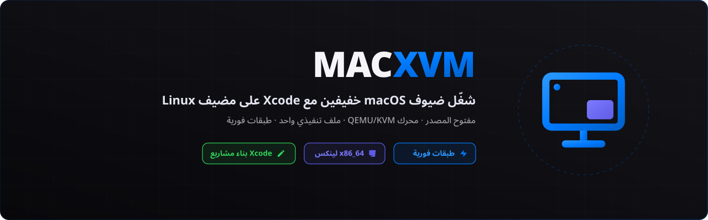
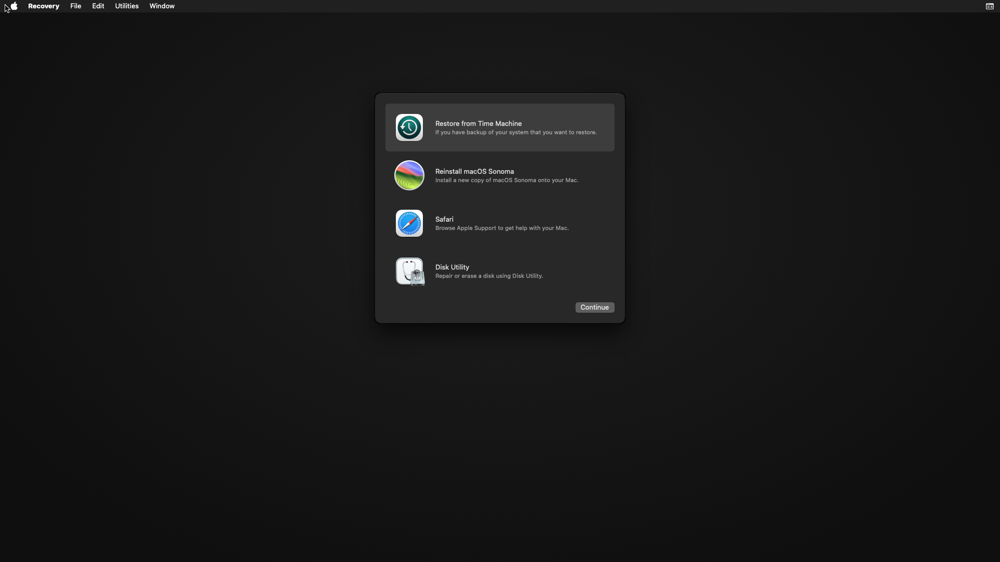
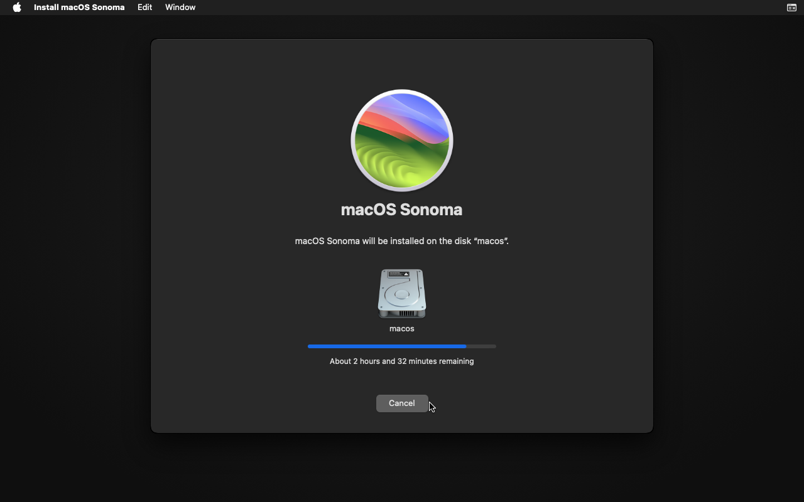
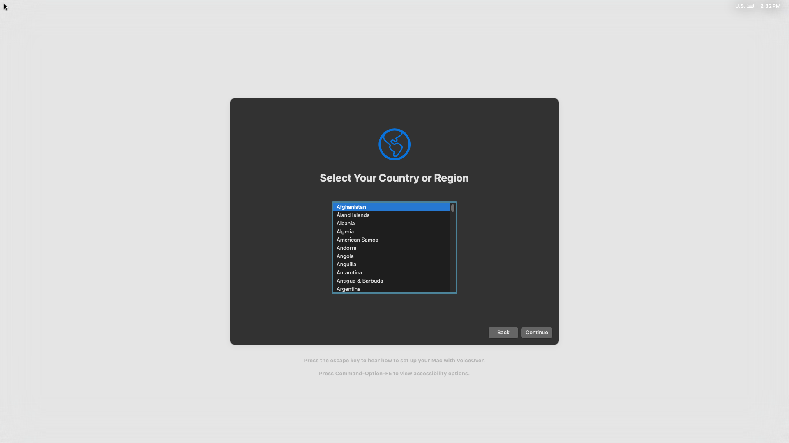
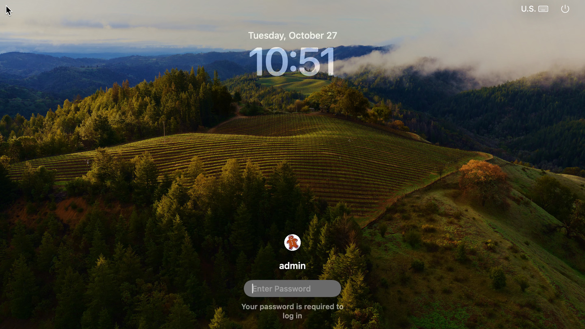

<a id="credits"></a>
# الشكر

تقف MacXVM على أكتاف من جعلوا تشغيل macOS على QEMU ممكنا أصلا. لا توزع أي برنامج من Apple، ولا برامج ثابتة، ولا محمل إقلاع، ولا مفاتيح، ولا تشغل إلا ما تقدمه أنت.

- **[OSX-KVM](https://github.com/kholia/OSX-KVM)** ل *kholia*: الدليل وسكربت الإقلاع الأصليين لتشغيل macOS على QEMU/KVM، والمرجع الذي يتكيف معه ملف الوسائط.
- **[ultimate-macOS-KVM](https://github.com/Coopydood/ultimate-macOS-KVM)** ل *Coopydood*: الدليل المصان الذي يحول سكربت الإقلاع إلى تثبيت كامل قابل للتكرار.
- **[QEMU](https://www.qemu.org)**: المحاكي الذي يشغل الضيف.
- **[OpenCore](https://github.com/acidanthera/OpenCorePkg)**: محمل الإقلاع الذي تستخدمه الأدلة، يثبته ويضبطه أنت.
- **[Apple](https://www.apple.com)**: macOS وXcode وiOS، علامات تجارية لشركة Apple Inc.، لا يوزعها هذا المشروع ولا يقربه.

‏MacXVM مشروع مفتوح المصدر مستقل، غير تابع لشركة Apple Inc. وغير معتمد منها.

---

<div align="center">

<a href="https://github.com/shadow-x78/macxvm">
  
</a>

# MacXVM

شغل ضيوف macOS خفيفين مع Xcode على مضيف Linux.

[](CHANGELOG.md)
[](LICENSE)


</div>

---

## اللغة

<a href="README.md">🇬🇧 English</a> · <a href="README_AR.md">🇸🇦 العربية</a>

---

## فهرس المحتويات

- [ما هذا؟](#what)
- [قبل أن تبدأ](#before)
- [التثبيت](#install)
- [شغّل جهازك الأول](#first-machine)
- [الأوامر التي ستستخدمها فعلا](#everyday)
- [كيف يعمل](#how)
- [ملف الوسائط](#args-file)
- [ملفات الموارد](#profiles)
- [السرعة](#speed)
- [صور من التشغيل](#screenshots)
- [الإطار القانوني والحدود](#legal)
- [حل المشاكل](#troubleshooting)
- [التوثيق](#documentation)
- [بنية المشروع](#structure)
- [المساهمة](#contributing)
- [الترخيص](#license)

---

<a id="what"></a>
## ما هذا؟

‏MacXVM أمر واحد يشغّل جهاز macOS افتراضي على حاسوب Linux، ثم يبني مشاريع Apple داخله.

تعطيه مضيف Linux فيه افتراض عتاد. ينشئ ضيف macOS، ويشغله تحت QEMU/KVM، ويفتح شاشة عندما تطلب ذلك، ويتيح لك تشغيل `xcodebuild` و`swift build` و`brew` وأي أمر آخر داخل الضيف من طرفية Linux.

```bash
macxvm exec macos -- swift --version          # ينفذ أمرا داخل الضيف
macxvm build --project . --scheme App         # يبني المشروع في مجلد المشروع
```

الأداة ملف تنفيذي واحد ثابت حجمه نحو 8.5 ميغابايت. لا خادم ولا خدمة ولا عملية في الخلفية: QEMU يعمل فقط ما دام جهاز مشغلا.

> **اقرأ [الإطار القانوني والحدود](#legal) قبل التثبيت.** تشغيل macOS على عتاد لم تصنعه Apple مشكلة ترخيص لا مشكلة تقنية. لا توزع MacXVM أي برنامج من Apple؛ أنت تقدمه، وأنت مسؤول عن طريقة استخدامه.

<a id="before"></a>
## قبل أن تبدأ

تحتاج أربعة أشياء. يفحصها `macxvm doctor` كلها ويخبرك بما ينقص.

| ما تحتاجه | لماذا | افحصه بـ |
|---|---|---|
| مضيف Linux x86_64 فيه VT-x أو AMD-V | الضيف يعمل على معالج المضيف | `lscpu \| grep -i virtual` |
| `/dev/kvm` يستطيع مستخدمك فتحه | بدونه يحاكي QEMU المعالج فيصبح الضيف بطيئا بلا فائدة | `ls -l /dev/kvm` |
| ‏QEMU 6.0 أو أحدث | `qemu-system-x86_64` و`qemu-img` هما المحرك | `qemu-system-x86_64 --version` |
| نحو 40 غيغابايت مساحة حرة | مثبت macOS نحو 1 غيغابايت، وقرص الضيف 64 غيغابايت، والباقي مساحة عمل | `df -h ~` |

```bash
macxvm doctor
```

كل سطر `[ok]` أو `[warn]`، والتحذير يذكر الأمر الذي يصلحه بالضبط. إن فشل فحص فتوقف هنا وأصلحه: لا شيء بعد هذه النقطة يعمل دون `/dev/kvm` وQEMU.

<a id="install"></a>
## التثبيت

تحتاج Go 1.22 أو أحدث، لبناء الملف التنفيذي فقط. لا توجد حزمة جاهزة بعد.

```bash
git clone https://github.com/shadow-x78/macxvm.git ~/MacXVM
cd ~/MacXVM

./scripts/install.sh          # يبني وينسخ macxvm إلى ‎~/.local/bin
export PATH="$HOME/.local/bin:$PATH"
macxvm version                # macxvm 0.10.3
```

إن لم يكن `~/.local/bin` في `PATH` فأضف سطر `export` هذا إلى `~/.zshrc` أو `~/.bashrc`، وإلا فلن تجد الطرفية التالية الأمر.

تفضل إبقاءه في المستودع؟ `make build` يترك الملف التنفيذي في `./bin/macxvm`.

<a id="first-machine"></a>
## شغّل جهازك الأول

هذا هو المسار كاملا بالترتيب. يستغرق نحو ساعة، معظمها انتظار مثبت Apple.

```bash
# 1. نزّل ملفات الإقلاع وأنشئ الجهاز (نحو 1 غيغابايت من التنزيل).
macxvm image prepare macos --profile cli

# 2. ثبّت macOS دون لمس الشاشة، حتى أول صفحة في Setup Assistant.
macxvm autoinstall macos --yes --accept-license
```

الخطوة 2 تقود مثبت Recovery لـmacOS عنك: تمسح القرص المطابق، وتقبل الترخيص عند تمرير `--accept-license`، وتثبت، وتعيد الإقلاع، ثم **تتوقف عند أول صفحة في Setup Assistant**. لا تنشئ حسابا ولا تخزن كلمة مرور. توقع من 40 إلى 90 دقيقة؛ و`--timeout MINUTES` يرفع الحد الافتراضي 240 دقيقة.

```bash
# 3. أكمل Setup Assistant بنفسك، في نافذة الشاشة.
macxvm open macos
```

في تلك النافذة اختر الدولة، وأنشئ حساب المدير المحلي (**اسم المستخدم يجب أن يكون `admin`**، وهو الافتراضي)، وتجاوز Apple ID إن لم ترده، ثم شغّل **إعدادات النظام › عام › المشاركة › تسجيل الدخول عن بعد**.

هذه الخطوة يدوية عن قصد: تلك الشاشات ملكك، لا ملك الأداة.

```bash
# 4. أعد الجهاز إلى MacXVM. سيسألك عن كلمة المرور التي وضعتها للتو.
macxvm finish macos --password-stdin --apps
```

اكتب كلمة المرور واضغط Enter؛ الإدخال مخفي، ولا تُكتب كلمة المرور في ملف ولا في سجل. تثبت هذه الخطوة مفتاح SSH وsudo، وتضبط الوضع الداكن وتعطّل النوم، وتخفف الجهاز، وتحوّله إلى العرض المدعوم، وتحذف التطبيقات التي وافقت على حذفها.

```bash
# 5. استخدمه.
macxvm start macos --vnc --wait
macxvm exec macos -- sw_vers
```

إن نجح كل شيء فـ`sw_vers` يطبع إصدار macOS من داخل الضيف. أصبح لديك جهاز macOS يعمل، والباقي في هذه الصفحة مرجع.

<details>
<summary><b>لم تظهر شاشة، أو لم يبدأ المثبت</b></summary>
<br>

- يحتاج `macxvm open macos` إلى جهاز يعمل بـVNC. إن قال إنه يعمل بلا شاشة فشغّل `macxvm open macos --restart`.
- تحتاج عارض VNC: `vncviewer` أو `gvncviewer` أو `remmina`. بدونه تطبع الأداة عنوان `127.0.0.1:59xx` لتفتحه بنفسك.
- يرفض `autoinstall` العمل إن كان الجهاز قد تجاوز مرحلة التثبيت الجديد. هذا فحص أمان: لن يمسح تثبيتا قائما.
- كل خطأ يُكتب على stderr برسالة تسمّي الأمر التالي. اقرأها قبل الإعادة.

</details>

<a id="everyday"></a>
## الأوامر التي ستستخدمها فعلا

| تريد أن | شغّل |
|---|---|
| ترى أجهزتك | `macxvm list` |
| تشغل جهازا بشاشة | `macxvm start NAME --vnc --wait` |
| تحصل على طرفية داخله | `macxvm ssh NAME` |
| تنفذ أمرا واحد بالداخل | `macxvm exec NAME -- CMD ...` |
| تنسخ ملفا إلى الداخل أو الخارج | `macxvm cp ./file NAME:/Users/admin/file` |
| تبني مشروع Xcode | `macxvm build --project . --scheme App` |
| تشارك مجلدا في الاتجاهين | `macxvm share add NAME --host ~/code/proj` ثم `macxvm share sync NAME` |
| تخفف الضيف | `macxvm slim NAME --level 1` |
| توقفه | `macxvm stop NAME` |
| تحذفه | `macxvm delete NAME --yes` |

القائمة الكاملة، علما بعلم، في [مرجع الأوامر](docs/COMMANDS_AR.md).

### استخدام جهاز كقالب

بعد أن يعمل جهاز، يمكنك ختمه وإنشاء نسخ تكلف ثانية وبضعة مئات كيلوبايت بدل نسخة قرص كاملة.

```bash
macxvm stop macos
macxvm base seal macos        # يعلّمه كأساس مختوم
macxvm create dev --base macos
macxvm start dev --vnc --wait
```

الأساس المختوم لا يُعدّل أبدا؛ وكل نسخة تحصل على طبقة قرص خاصة وNVRAM خاصة. ولجهاز مؤقت يختفي بعد أمر واحد:

```bash
macxvm run --from macos -- sh -c 'swift --version'
```

<a id="how"></a>
## كيف يعمل

```
طرفيتك  ->  macxvm  ->  عملية QEMU/KVM  ->  ضيف macOS
                |                              |
                +---------- ssh وscp وrsync ----+
```

- **مجلد الحالة** هو `~/.local/share/macxvm` (أو `$MACXVM_HOME`، أو `$XDG_DATA_HOME/macxvm`). يحمل مجلدا لكل جهاز، وأصول الإقلاع، ومفتاح SSH الذي تولده الأداة.
- كل جهاز **مجلد** لا قاعدة بيانات: `config.json` و`disk.qcow2` و`nvram.fd` وملف الوسائط والسجلات. تستطيع نسخه أو فحصه أو حذفه.
- تتكلم الأداة مع الضيف عبر **SSH إلى `127.0.0.1:<port>`** فقط، لا عبر بروتوكول خاص. كل ما تستطيع فعله بـ`ssh` يبقى متاحا بيدك.
- **لا خادم.** `start` يشغل QEMU ويسجل معرّفه ومقبس QMP؛ و`status` يقرأهما؛ و`stop` يطلب إطفاء الضيف ثم يتصاعد فقط بعده.

<a id="args-file"></a>
### ملف الوسائط

لا تثبت MacXVM تعريف جهاز في الكود. تقرأ سطر أوامر QEMU الذي تقدمه، وتستبدل عددا قليلا من العناصر النائبة، وتشغل النتيجة. القالب الافتراضي في `resources/args-template.txt`؛ ويكتب لك `macxvm image prepare` واحدا.

```bash
qemu-system-x86_64 \
  -accel kvm \
  -cpu host \
  -smp {{CPUS}} \
  -m {{RAM_MIB}} \
  -drive file={{DISK_IMG}},format=qcow2,{{DISK_OPTS}} \
  -netdev {{NETDEV}} \
  -device virtio-net-pci,netdev=net0,mac={{MAC}}
```

| العنصر النائب | القيمة |
|-------------|-------|
| `{{CPUS}}` | عدد المعالجات |
| `{{CORES}}` | نصف المعالجات، وأقل شيء واحد |
| `{{RAM_MIB}}` | الذاكرة بالميغابايت |
| `{{DISK_IMG}}` | المسار المطلق للقرص |
| `{{DISK_OPTS}}` | `cache=writeback`، أو `cache=unsafe` لجهاز مؤقت |
| `{{NVRAM}}` | ملف NVRAM، عندما يملك الجهاز واحدا |
| `{{ASSETS}}` | مجلد أصول الإقلاع |
| `{{MAC}}` | عنوان MAC للجهاز |
| `{{NETDEV}}` | تحويل منفذ SSH |

تضيف MacXVM الوسائط `-name` و`-pidfile` و`-qmp` و`-display` و`-vnc` بنفسها، فلا يجوز أن يحوي الملف عليها. احذف `-monitor stdio` من أي سكربت تنسخه من مكان آخر. القواعد الكاملة، بما فيها تكييف سكربت إقلاع قائم، في [docs/ARGS_FILE_AR.md](docs/ARGS_FILE_AR.md).

<a id="profiles"></a>
## ملفات الموارد

| الملف | المعالجات | الذاكرة | القرص | استخدمه لـ |
|---|---|---|---|---|
| `cli` (الافتراضي) | 6 | 12 غيغابايت | 64 غيغابايت | حزم Swift وHomebrew والسكربتات، وXcode إنثبته |
| `xcode` | 4 | 8 غيغابايت | 100 غيغابايت | تثبيتات Xcode الكبيرة والمحاكيات |

هذه أحجام أجهزة منطقية، لا وعود بمساحة حرة داخل APFS ولا بسلاسة سطح المكتب الرسومي. غيرها بـ`--cpus` و`--ram` و`--disk` عند إنشاء جهاز، أو بـ`macxvm resize` وهو متوقف.

<a id="speed"></a>
## السرعة

| العملية | مقيسة على الجهاز الذي يبني هذا المشروع |
|---|---|
| `list` و`status` | 3 مللي ثانية |
| الملف التنفيذي | 8,966,304 بايت، ثابت `linux/amd64` |
| نسخة من أساس مختوم | أقل من ثانية، وبضعة مئات كيلوبايت على القرص |
| التكلفة عند الخمول | لا تبقى أي عملية لـMacXVM حية |

زمن الإقلاع يعتمد على ملف الوسائط وعلى قرصك؛ شغّل `scripts/bench.sh BASE` لقياس مضيفك. يحصل الضيف على سرعة المضيف لأن ملف الوسائط يفعّل `-accel kvm` ونموذج معالج المضيف وأقراص AHCI (فلا يوجد لدى macOS تعريف قرص virtio) وعرض Bochs الذي يقوده macOS بـ`AppleBochVGAFB`.

<a id="screenshots"></a>
## صور من التشغيل

هذه أمثلة من تشغيل حقيقي، وليست وعدا بأن كل مرحلة ستبدو مثلها على مضيفك.






<a id="legal"></a>
## الإطار القانوني والحدود

> ‏MacXVM مشروع مفتوح المصدر مستقل، غير تابع لشركة Apple Inc. وغير معتمد منها. macOS وXcode وiOS علامات تجارية لشركة Apple Inc. لا يوزع هذا المشروع أي برنامج من Apple؛ أنت تقدمه، وأنت مسؤول عن الالتزام بترخيص Apple.

1. **ترخيص Apple يسمح بـmacOS في جهاز افتراضي على عتاد من Apple فقط.** تشغيله تحت QEMU/KVM على حاسوب شخصي يخالف ذلك الترخيص، وقد أنفذته Apple في المحاكم. MacXVM مشغّل: لا يوزع برامج Apple ولا برامجها الثابتة ولا مفاتيحها ولا محمل إقلاعها، ولا يشغل إلا ما تقدمه أنت. البديل الملتزم هو جهاز Mac، أو Mac مستأجر في السحابة.
2. **x86_64 فقط.** تدعم Apple أجهزة Intel حتى macOS 26، فالضيف محدود بـmacOS ≤ 26 وبإصدارات Xcode التي تعمل عليه. اختر الاثنين معا من ملاحظات إصدار Xcode؛ ولا تثبت هذه الأداة زوج إصدارات.
3. **لا Metal ولا تسريع ثلاثي الأبعاد.** العرض المدعوم إطار Bochs يقوده `AppleBochVGAFB`. هو تعريف macOS حقيقي، لكنه ثنائي الأبعاد فقط: محاكي iOS وتطبيقات Metal يبقيان بطيئين. وتمرير بطاقة NVIDIA ليس مسارا مدعوما في macOS.
4. **لا تحدّث macOS داخل الضيف.** تحديث النظام قد يكسر الإقلاع. ولهذا يعطّل التخفيف من المستوى 1 التحديثات التلقائية.
5. **أنت تقدم أصول الإقلاع.** تعريف الجهاز ومحمل الإقلاع والبرامج الثابتة وصورة المثبت تأتي منك. يطبع `macxvm image link` مصادرها، ويجلبها `macxvm image prepare` إلى مجلد حالتك؛ ولا يُخزَّن شيء من Apple في هذا المستودع ولا في أي إصدار منه.

<a id="troubleshooting"></a>
## حل المشاكل

| العَرَض | السبب | الإصلاح |
|---|---|---|
| `macxvm: /dev/kvm is not readable` | مستخدمك ليس في مجموعة `kvm` | `sudo usermod -aG kvm $USER` ثم اخرج وادخل من جديد |
| الضيف بطيء جدا | لم يختر QEMU تسريع KVM | أضف `-accel kvm` إلى ملف الوسائط؛ و`macxvm doctor` يبلغ عن ذلك |
| الشاشة تبقى سوداء | لا عرض للضيف، أو العارض غير مثبت | `macxvm open macos --restart` |
| `the destination has no migration plan` | أُلغي ترحيل قبل وصول الخطة | أعد `macxvm migrate NAME --to USER@HOST --check` |
| `autoinstall` يرفض العمل | الجهاز تجاوز مرحلة التثبيت الجديد | لن يمسح تثبيتا قائما؛ أنشئ جهازا جديدا |
| `permission denied (publickey)` عبر SSH | تسجيل الدخول عن بعد متوقف في الضيف | شغّله في الضيف ثم `macxvm ssh-key --install NAME` |

المزيد، مع مخرجات كل أمر بالضبط، في [docs/TROUBLESHOOTING_AR.md](docs/TROUBLESHOOTING_AR.md).

<a id="documentation"></a>
## التوثيق

| المستند | ما يجيب عنه |
|---|---|
| [INSTALLATION_AR.md](docs/INSTALLATION_AR.md) | المتطلبات والبناء ومجلد الحالة وكيف تحذف كل شيء |
| [COMMANDS_AR.md](docs/COMMANDS_AR.md) | كل أمر وكل علم |
| [BUILDING_AR.md](docs/BUILDING_AR.md) | ملف المشروع ومسار البناء والبناء المؤقت |
| [ARGS_FILE_AR.md](docs/ARGS_FILE_AR.md) | تعريف الجهاز بالتفصيل |
| [GPU_AR.md](docs/GPU_AR.md) | العرض وتعريف macOS الحقيقي وحدود التمرير |
| [SLIM_AR.md](docs/SLIM_AR.md) | ما يغيّره كل مستوى تخفيف وكيف تتراجع عنه |
| [ARCHITECTURE_AR.md](docs/ARCHITECTURE_AR.md) | الحزم ودورة الحياة وتخطيط الحالة |
| [TROUBLESHOOTING_AR.md](docs/TROUBLESHOOTING_AR.md) | الأعطال الشائعة وإصلاحاتها بالضبط |
| [DECISIONS.md](docs/DECISIONS.md) | كل انحراف متعمد وسببه |

كل مستند موجود بالإنجليزية وبالعربية، و[README الإنجليزي](README.md) يقابل هذه الصفحة.

<a id="structure"></a>
## بنية المشروع

```
macxvm/
├── cmd/macxvm/        نقطة الدخول
├── internal/          حزمة لكل مجال (config وstore وqemu وsshx وcmds ...)
├── resources/         قوالب الوسائط وسكربتات الضيف
├── scripts/           التثبيت والقياس وفحوص الأسلوب
├── docs/              الأدلة بالإنجليزية والعربية
├── driver/            حزمة امتداد النواة MXGPU (تجريبية)
├── assets/            الشعار وصور التشغيل
└── Makefile           بناء واختبار وتثبيت وتنظيف
```

الخريطة المفصلة في [ARCHITECTURE_AR.md](docs/ARCHITECTURE_AR.md).

<a id="contributing"></a>
## المساهمة

1. اعمل fork للمستودع وأنشئ فرعا: `feature/` أو `fix/` أو `docs/` أو `chore/`.
2. أبقِ `go vet ./...` و`go test ./...` و`make build` خضراء، وأبقِ رؤوس الملفات والتنسيق كما هي.
3. أضف سطرا في `CHANGELOG.md`.
4. اكتب الارتباط بالصيغة `macxvm | vX.Y.Z | type: description` وافتح طلب سحب إلى `main`.

اقرأ [CONTRIBUTING.md](CONTRIBUTING.md) و[CODE_OF_CONDUCT.md](CODE_OF_CONDUCT.md). وأبلغ عن المشاكل عبر [GitHub Issues](https://github.com/shadow-x78/macxvm/issues).

<a id="license"></a>
## الترخيص

موزع تحت [ترخيص MIT](LICENSE).

---

<div align="center">

بُني بواسطة <a href="https://github.com/shadow-x78">shadow-x78</a> ·
[سجل التغييرات](CHANGELOG.md) ·
[الأمان](SECURITY.md)

<sub>&copy; 2026 MacXVM</sub>

</div>
