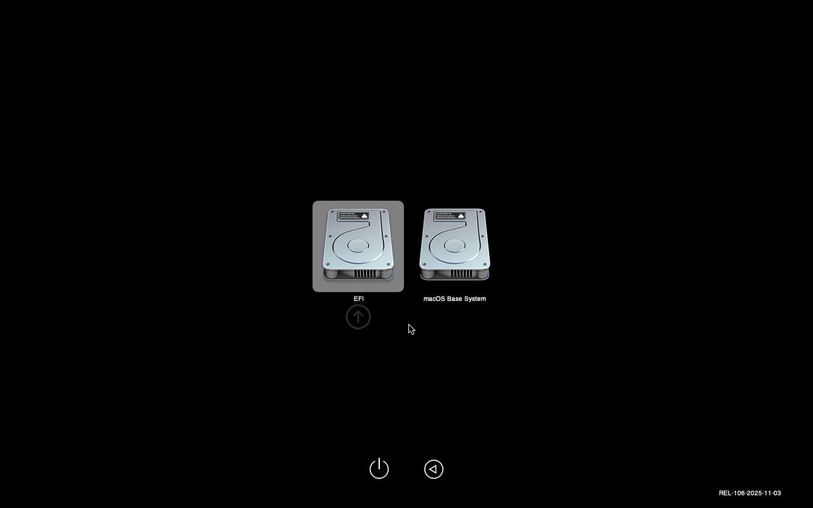
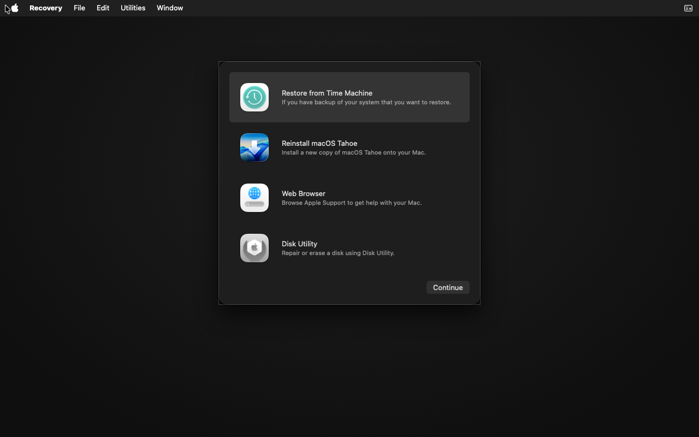
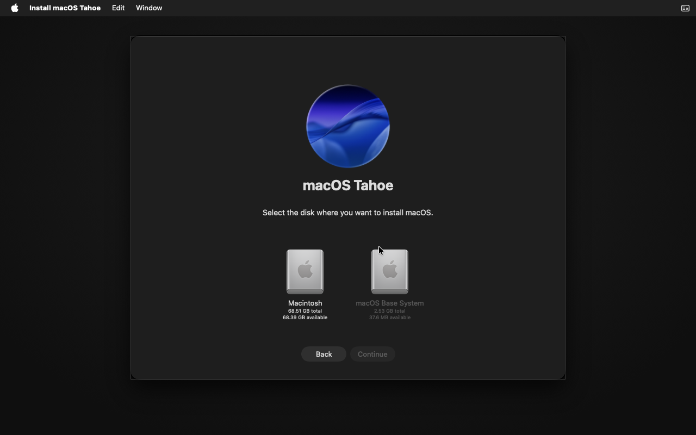
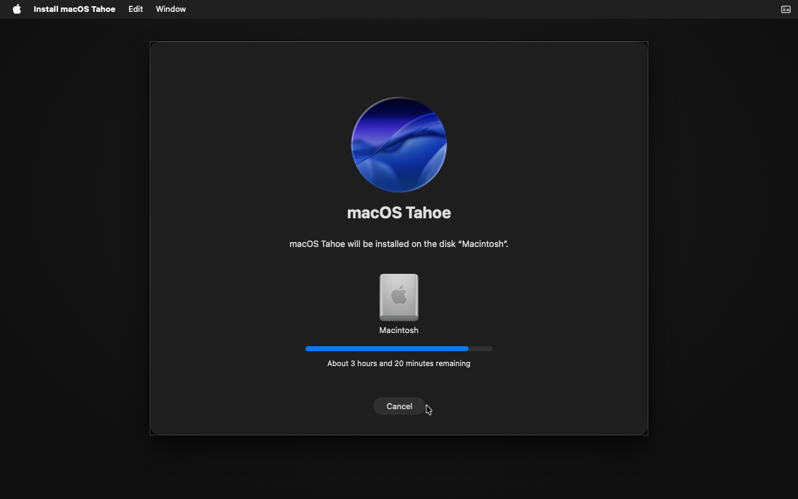
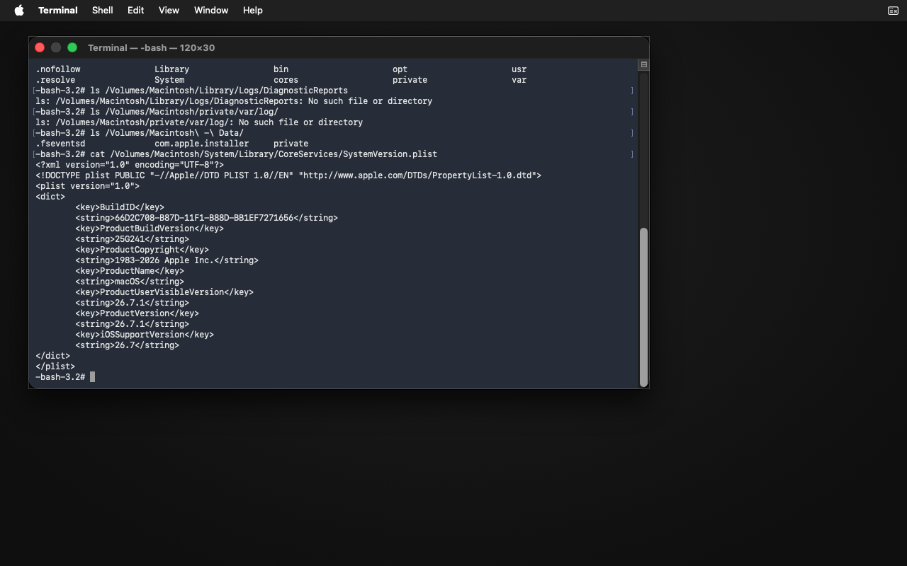

<a id="credits"></a>
# الشكر

تقف MacXVM على أكتاف من جعلوا تشغيل macOS على QEMU ممكنًا أصلًا. لا توزّع أي برنامج من Apple، ولا برامج ثابتة، ولا محمّل إقلاع، ولا مفاتيح، ولا تُشغّل إلا ما تقدّمه أنت.

- **[OSX-KVM](https://github.com/kholia/OSX-KVM)** لـ *kholia*: الدليل وسكربت الإقلاع الأصليين لتشغيل macOS على QEMU/KVM، والمرجع الذي يتكيّف معه ملف الوسائط.
- **[ultimate-macOS-KVM](https://github.com/Coopydood/ultimate-macOS-KVM)** لـ *Coopydood*: الدليل المُصان الذي يحوّل سكربت الإقلاع إلى تثبيت كامل قابل للتكرار.
- **[QEMU](https://www.qemu.org)**: المحاكي الذي يشغّل الضيف.
- **[OpenCore](https://github.com/acidanthera/OpenCorePkg)**: محمّل الإقلاع الذي تستخدمه الأدلّة، يثبّته ويضبطه أنت.
- **[Apple](https://www.apple.com)**: macOS وXcode وiOS، علامات تجارية لشركة Apple Inc.، لا يوزّعها هذا المشروع ولا يقرّبه.

MacXVM مشروع مفتوح المصدر مستقل، غير تابع لشركة Apple Inc. وغير معتمد منها.

---

<div align="center">

<a href="https://github.com/shadow-x78/macxvm">
  
</a>

# MacXVM

شغّل ضيوف macOS خفيفين مع Xcode على مضيف Linux.

[](CHANGELOG.md)
[](LICENSE)


</div>

---

## اللغة

<a href="README.md">🇬🇧 English</a> · <a href="README_AR.md">🇸🇦 العربية</a>

---

## فهرس المحتويات

- [نظرة عامة](#نظرة-عامة)
- [الإطار القانوني والحدود](#الإطار-القانوني-والحدود)
- [المتطلبات](#المتطلبات)
- [التثبيت](#التثبيت)
- [المزايا](#المزايا)
- [ملف الوسائط](#ملف-الوسائط)
- [البدء السريع](#البدء-السريع)
- [صور من التشغيل](#screenshots)
- [الملفات التعريفية](#الملفات-التعريفية)
- [التخفيف](#التخفيف)
- [بناء المشاريع](#بناء-المشاريع)
- [مرجع الأوامر](#مرجع-الأوامر)
- [السرعة](#السرعة)
- [تنظيم المشروع](#تنظيم-المشروع)
- [التوثيق](#التوثيق)
- [المساهمة](#المساهمة)
- [الترخيص](#الترخيص)

---

<a id="overview"></a>
## نظرة عامة

تحوّل MacXVM جهاز Linux إلى مزرعة بناء لمشاريع macOS. تسجّل ضيوف macOS، وتشغّلهم تحت QEMU/KVM، وتخفّفهم حتى يهدأوا في وضع الخمول، وتثبّت Xcode داخلهم، وتبني مشاريعك من Linux عبر `rsync` و`ssh`.

الأداة ملف تنفيذي واحد ثابت بحجم نحو 4 ميغابايت بلا خادم دائم. العملية الوحيدة التي تبقى حيّة هي QEMU نفسها، فلا يحمل المضيف الخامل شيئًا إطلاقًا.

<div dir="ltr" align="left">

```
macxvm create demo --args-file ./args.txt --assets ./assets
macxvm start demo --install --vnc
macxvm slim demo --level 1
macxvm tools install demo clt
macxvm xcode install demo --xip ./Xcode.xip
macxvm base seal demo
macxvm build --project . --scheme App
```

</div>

صورة أساس ختم مع طبقات qcow2 هي ما يجعل هذا سريعًا: الجهاز الجديد يكلّف بضعة مئات كيلوبايت وثانية واحدة، لا نسخة من مئة غيغابايت. وتختفي الطبقات مع `macxvm run`، الذي يشغّل جهازًا مؤقتًا وينفّذ أمرًا واحدًا فيه ثم يحذفه.

لا تصف MacXVM جهاز macOS بنفسها أبدًا. تعريف الجهاز يعيش في ملف وسائط تكتبه أنت، ف تستبدل MacXVM فيه عددًا قليلًا من العناصر النائبة وتشغّل QEMU بالنتيجة.

<a id="legal"></a>
## الإطار القانوني والحدود

> MacXVM مشروع مفتوح المصدر مستقل، غير تابع لشركة Apple Inc. وغير معتمد منها. macOS وXcode وiOS علامات تجارية لشركة Apple Inc. لا يوزّع MacXVM أي برنامج من Apple؛ المستخدم يقدّم كل برمجيات Apple ويتحمّل مسؤوليتها والامتثال لشروط ترخيصها.

اقرأ هذا قبل أن تثبّت شيئًا:

1. **ترخيص macOS من Apple يسمح بتشغيل macOS داخل جهاز افتراضي على أجهزة من إنتاج Apple فقط.** تشغيل macOS تحت QEMU/KVM على حاسوب مكتبي خرق لترخيص Apple، وقد نفّذته Apple أمام القضاء. MacXVM مُشغِّل فقط: لا يوزّع أي برنامج من Apple ولا برامج ثابتة ولا مفاتيح ولا محمّلات إقلاع، ولا يشغّل إلا ما تقدّمه. **المسؤولية عليك.** والبدائل المطابقة هي جهاز Mac (استخدم مواصفة أجهزة Apple) أو Mac مستأجر في السحابة.
2. **x86_64 فقط.** الضيف نظام macOS بمعمارية x86_64. تدعم Apple أجهزة Intel حتى macOS 26، فيقصر الضيف على macOS ≤ 26 وبالتالي على إصدارات Xcode التي تعمل عليه. اختر إصدار macOS وإصدار Xcode معًا بالرجوع إلى ملاحظات إصدار Xcode. لا يثبّت هذا المشروع أزواج إصدارات بشكل ثابت.
3. **المضيف.** Linux بمعمارية x86_64 مع المحاكاة الافتراضية (Intel VT-x أو AMD-V)، و`/dev/kvm` يستطيع مستخدمك استعماله، وQEMU بإصدار 6.0 أو أحدث. لا دعم لمضيف Linux بمعمارية ARM.
4. **لا تسريع رسومي.** واجهة المستخدم ومحاكي iOS يُعرضان برمجيًا. البناء سليم، والمحاكي بطيء.
5. **الهشاشة.** قد يكسر تحديث نظام macOS داخل جهاز افتراضي كهذا الإقلاع. المستوى الأول من التخفيف يطفئ التحديثات التلقائية، ولا ينبغي أن تشغّل تحديثات النظام داخل الضيف.
6. **أصول الإقلاع مسؤوليتك.** تعريف الجهاز ومحمّل الإقلاع والبرامج الثابتة وصورة مثبّت macOS تأتي منك، مثلًا باتباع توثيق المشاريع المفتوحة المذكورة في [الشكر](#credits). لا ينسخ MacXVM أي محتوى منها.
7. **لا يُخزَّن أي برنامج من Apple في هذا المستودع ولا في أي إصدار منه.** يطبع `macxvm image link` عناوين أصول الإقلاع، ويجلبها `macxvm image prepare` إلى مجلد حالة MacXVM على جهازك، حين تطلب ذلك فقط. يأتي مثبّت Apple من خدمة استعادة Apple ويُفحص مقابل توقيع Apple قبل استعماله. لا شيء من Apple يُودَع ولا يُوسَم ولا يُرفع، فلا يحتوي المستودع على أي محتوى من Apple ولا يمكن إغلاقه بسببه.

<a id="requirements"></a>
## المتطلبات

<div dir="rtl" align="right">

| المتطلب | التفصيل |
|----------|---------|
| المضيف | Linux x86_64، محاكاة افتراضية عتادية، و`/dev/kvm` يستطيع مستخدمك استعماله |
| QEMU | `qemu-system-x86_64` و`qemu-img`، بإصدار 6.0 أو أحدث |
| أدوات المضيف | `ssh` و`scp` و`rsync` و`ssh-keygen` |
| الضيف | macOS بمعمارية x86_64 ≤ 26، تثبّته أنت، مع تفعيل Remote Login |
| Go | 1.22 أو أحدث، لبناء MacXVM فقط |

</div>

افحص كل ذلك بـ:

<div dir="ltr" align="left">

```bash
macxvm doctor
```

</div>

كما يخبرك الفحص حين لا يختار QEMU مسرّع KVM من تلقاء نفسه. بعض البناءات لا تستعمل KVM إلا حين
يُسمّى صراحة، والجهاز الذي يطلب معالج المضيف يحتاجه. أضف `-accel kvm` إلى ملف وسائط الجهاز في تلك الحالة:

<div dir="ltr" align="left">

```bash
qemu-system-x86_64 \
  -accel kvm \
  -cpu host \
  ...
```

</div>

<a id="installation"></a>
## التثبيت

**من المصدر:**

<div dir="ltr" align="left">

```bash
git clone https://github.com/shadow-x78/macxvm.git ~/MacXVM
cd ~/MacXVM && ./scripts/install.sh
```

</div>

**بـ Makefile:**

<div dir="ltr" align="left">

```bash
git clone https://github.com/shadow-x78/macxvm.git && cd macxvm
make build
make install          # يثبّت في ~/.local/bin/macxvm
```

</div>

الملف التنفيذي بحجم نحو 7 ميغابايت، ثابت ومبني لـ `linux/amd64`. لا يحتاج خادمًا دائمًا ولا خدمة. الدليل الكامل، بما فيه مجلد الحالة والحذف، في [docs/INSTALLATION_AR.md](docs/INSTALLATION_AR.md).

<a id="features"></a>
## المزايا

- تسجيل ضيوف macOS وإقلاعهم وإيقافهم ونسخهم وحذفهم تحت QEMU/KVM
- ملف وسائط من المستخدم كتعريف للجهاز: بلا طراز معالج ثابت، ولا مفاتيح SMC، ولا قيم SMBIOS، ولا إعدادات OpenCore، ولا مسارات برامج ثابتة
- صور أساس ختم مع طبقات qcow2: الجهاز الجديد يكلّف بضعة مئات كيلوبايت وثانية واحدة
- أجهزة مؤقتة عبر `macxvm run`: تُحذف الطبقة بعدها، حتى عند مقاطعة الأمر
- مستويان من التخفيف يخفّضان كلفة الخمول في الضيف، مع قائمة منع تحمي SSH والشبكة، واستعادة تعكس التغيير
- تثبيت أدوات سطر الأوامر وHomebrew وXcode داخل الضيف من المضيف
- `xcodebuild` و`swift build` على ضيف بعيد، مع الاحتفاظ بالبيانات المشتقة بين البناءات
- ملف مشروع يحمل قيم البناء والجهاز وصورة الأساس الافتراضية
- وضع بلا واجهة افتراضيًا، وشاشة VNC على واجهة loopback حين تحتاج رؤية الشاشة
- ملف تنفيذي واحد ثابت بحجم نحو 4 ميغابايت، بمكتبة Go القياسية فقط، بلا وحدات خارجية، بلا خادم دائم، بلا عملية خلفية

<a id="args-file"></a>
## ملف الوسائط

ملف الوسائط هو تعريف الجهاز الذي يأتي بك. يستبدل MacXVM فيه عددًا قليلًا من العناصر النائبة ويضيف الأعلام التي يحتاجها لإدارة الجهاز.

<div dir="ltr" align="left">

```bash
qemu-system-x86_64 \
  -accel kvm \
  -cpu host \
  -smp {{CPUS}} \
  -m {{RAM_MIB}} \
  -drive file={{DISK_IMG}},format=qcow2,{{DISK_OPTS}} \
  -drive file={{ASSETS}}/efi.img,format=raw \
  -netdev {{NETDEV}} \
  -device virtio-net-pci,netdev=net0,mac={{MAC}}

#install -drive file={{ASSETS}}/installer.img,format=raw
```

</div>

<div dir="rtl" align="right">

| العنصر | القيمة |
|--------|--------|
| `{{CPUS}}` | عدد أنوية المعالج في الجهاز |
| `{{CORES}}` | نصف الأنوية، ولا يقل عن واحد |
| `{{RAM_MIB}}` | ذاكرة الجهاز بالميغابايت |
| `{{DISK_IMG}}` | المسار المطلق لقرص الجهاز |
| `{{DISK_OPTS}}` | `cache=writeback`، أو `cache=unsafe` لجهاز مؤقت |
| `{{NVRAM}}` | المسار المطلق لملف NVRAM، فقط حين يملك الجهاز واحدًا |
| `{{ASSETS}}` | مجلد أصول الجهاز |
| `{{MAC}}` | عنوان MAC للجهاز |
| `{{NETDEV}}` | `user,id=net0,hostfwd=tcp:127.0.0.1:<port>-:22` |

</div>

العناصر `{{DISK_IMG}}` و`{{NETDEV}}` و`{{MAC}}` و`{{RAM_MIB}}` و`{{CPUS}}` مطلوبة. ويضيف MacXVM بنفسه `-name` و`-pidfile` و`-qmp` و`-display` و`-vnc`، فلا يجوز أن يحتويها ملف الوسائط. وأغلب سكربتات الإقلاع في المشاريع الأخرى تستخدم `-monitor stdio`، فاحذف ذلك السطر.

الدليل الكامل، بما فيه تكييف سكربت إقلاع جاهز، في [docs/ARGS_FILE_AR.md](docs/ARGS_FILE_AR.md).

<a id="quick-start"></a>
## البدء السريع

الطريقة السريعة: دع MacXVM يجلب أصول الإقلاع ويسجّل الجهاز.

<div dir="ltr" align="left">

```bash
# 1. اجلب مثبّت Apple ومحمّل الإقلاع OpenCore، وسجّل الجهاز بهما
macxvm image prepare demo --macos sequoia

# 2. ثبّت macOS داخل الضيف
macxvm start demo --install --vnc
#    صل بعميل VNC بالعنوان 127.0.0.1:<المنفذ الذي يطبعه macxvm> واتّبع دليل
#    التثبيت الخاص بالمشروع الذي جاءت منه أصولك
```

</div>

الطريقة بأصولك الخاصة: أحضر ملف وسائط وأصول الإقلاع بنفسك.

<div dir="ltr" align="left">

```bash
# 1. سجّل الجهاز
macxvm create demo --args-file ./args.txt --assets ./assets

# 2. ثبّت macOS داخل الضيف
macxvm start demo --install --vnc
#    صل بعميل VNC بالعنوان 127.0.0.1:<المنفذ الذي يطبعه macxvm> واتّبع دليل
#    التثبيت الخاص بالمشروع الذي جاءت منه أصولك
```

</div>

### ما يفعله `macxvm image prepare`

| الخطوة | المصدر |
|--------|--------|
| مثبّت macOS | خدمة الاستعادة من Apple، عبر جلسة الخدمة. تُفحص قائمة الأجزاء وتوقيع Apple، ثم تُحوَّل الصورة إلى قرص خام بـ `dmg2img` |
| محمّل الإقلاع OpenCore | مستودع مجتمع OSX-KVM |
| برمجية UEFI لـ QEMU | نفس المستودع، الزوج `OVMF_CODE_4M.fd` و`OVMF_VARS-1920x1080.fd` |
| ملف وسائط الجهاز | يُكتب في مجلد الأصول بالرايات التي يحتاجها macOS على KVM، وعدّله كما شئت |
| جدول تقسيم القرص | تكتبه الأداة، ليرى firmware وmacOS القرص قبل تثبيت أي شيء عليه |

تقع الأصول في `~/.local/share/macxvm/assets` ويشاركها كل الأجهزة. لا يُنزَّل شيء بلا أمر منك،
ومستودع المشروع لا يضم أي برنامج من Apple.

<div dir="ltr" align="left">

```bash
macxvm image prepare demo --macos sonoma --cpus 4 --ram 8G --disk 64 --profile cli
```

</div>

الإصدارات: `high-sierra` و`mojave` و`catalina` و`big-sur` و`monterey` و`ventura`
و`sonoma` و`sequoia` و`tahoe`.

<a id="screenshots"></a>
## صور من التشغيل

الصور أدناه من تشغيل حقيقي للأداة على مضيف Linux، بـ `macxvm image prepare` و`macxvm start --install --vnc`. وهي شاشة الضيف كما هي.

<div dir="ltr" align="left">

| The boot loader of the community | The environment of the recovery |
|---|---|
|  |  |

| The installer sees the disk of the machine | The installation runs |
|---|---|
|  |  |

| A terminal inside the guest |
|---|
|  |

</div>

<a id="first-boot-checklist"></a>
### قائمة إقلاع أول مرة

0. في بيئة الاستعادة، امسح قرص الجهاز، لأن المثبّت لا يعرض إلا حجمًا بصيغة APFS. افتح **Disk Utility**، واختر قرص الجهاز على اليسار، ثم **Erase**، واختر **APFS** وامسحه. وفي طرفية بيئة الاستعادة يكون الأمر سطرًا واحدًا:

<div dir="ltr" align="left">

```bash
diskutil eraseDisk APFS "Macintosh HD" GPTFormat /dev/disk2
```

</div>

1. أنشئ المستخدم `admin` بكلمة مرور، وتخطَّ Apple ID وiCloud وSiri والتحليلات.
2. إعدادات النظام، ثم عام، ثم المشاركة، ثم **Remote Login**: مفعّل.
3. في طرفية داخل الضيف:

<div dir="ltr" align="left">

```bash
sudo sh -c 'echo "admin ALL=(ALL) NOPASSWD: ALL" > /etc/sudoers.d/admin'
```

</div>

4. على المضيف، سلّم مفتاح MacXVM إلى الضيف:

<div dir="ltr" align="left">

```bash
macxvm ssh-key --install demo
```

</div>

5. خفّف الضيف وثبّت الأدوات:

<div dir="ltr" align="left">

```bash
macxvm slim demo --level 1
macxvm tools install demo clt
macxvm xcode install demo --xip ./Xcode.xip
macxvm slim demo --level 2
```

</div>

6. احتفظ بالنتيجة كصورة أساس:

<div dir="ltr" align="left">

```bash
macxvm stop demo
macxvm base seal demo
```

</div>

7. ابنِ:

<div dir="ltr" align="left">

```bash
macxvm clone demo work
macxvm build --vm work --project . --scheme App
```

</div>

<a id="profiles"></a>
## الملفات التعريفية

<div dir="rtl" align="right">

| الملف | المحتوى | الموارد الافتراضية | الاستخدام |
|-------|---------|---------------------|-----------|
| `xcode` (افتراضي) | macOS خفيف + أدوات سطر الأوامر + Xcode | 4 أنوية / 8192 MiB / 100 GiB | `xcodebuild` والمحاكيات وملفات `.xcodeproj` و`.xcworkspace` |
| `cli` | macOS خفيف + أدوات سطر الأوامر | 2 أنوية / 4096 MiB / 32 GiB | حزم Swift لمنصة macOS وHomebrew والسكربتات |

</div>

<div dir="rtl" align="right">

| | `cli` | `xcode` |
| :--- | :---: | :---: |
| `swift build` / `swift test` لمنصة macOS | ✅ | ✅ |
| حزم Homebrew وgit والسكربتات | ✅ | ✅ |
| `xcodebuild` و`.xcodeproj` و`.xcworkspace` | ❌ رمز الخروج 9 | ✅ |
| حزمة iOS SDK ومحاكي iOS | ❌ أدوات سطر الأوامر فيها حزمة macOS فقط | ✅ بعرض برمجي |

</div>

<a id="slimming"></a>
## التخفيف

<div dir="ltr" align="left">

```bash
macxvm slim demo --level 1
macxvm slim demo --level 2 --measure
macxvm slim demo --level 3
macxvm slim demo --restore
```

</div>

المستوى الأول يطفئ فهرسة Spotlight وTime Machine والتحديثات التلقائية والحركات ومؤقتات النوم. والمستوى الثاني يعطّل أيضًا مهام launchd المذكورة في `resources/slim-labels.txt`، ويتخطّى كل مهمة غير موجودة في إصدار macOS لديك. والمستوى الثالث يحذف التطبيقات التي لا يحتاجها جهاز البناء، وبقايا التثبيت، والتحديثات، والمخابئ، والسجلات، ومَشغِّلات المحاكي. ويبقى Safari وXcode.

لا يُمَس في المستوى الثاني إلا التسميات الموجودة في ذلك الملف. وقائمة منع في الشيفرة تحذف كل تسمية تكسر SSH أو الشبكة أو خادم النوافذ. لا يُعدَّل مجلد النظام أبدًا، ولا تُغيَّر SIP. والمستوى الثالث يحذف تطبيقات `/Applications` والمخابئ فقط.

التفاصيل في [docs/SLIM_AR.md](docs/SLIM_AR.md).

<a id="building"></a>
## بناء المشاريع

<div dir="ltr" align="left">

```bash
macxvm build --project . --scheme App
```

</div>

يُنسخ المشروع إلى الضيف بـ `rsync -a`، ويجري البناء هناك بـ `xcodebuild` أو `swift build`، وتُبثّ المخرجات. ولا يُشغَّل الجهاز إلا إن لم يكن يعمل، ويُوقف من جديد بعدها حتى عند فشل البناء.

<div dir="ltr" align="left">

```bash
macxvm build --ephemeral --from base-xcode --project . --scheme App
```

</div>

يبني في طبقة مؤقتة تُحذف بعدها. الدليل الكامل، بما فيه ملف المشروع وجلب النتائج، في [docs/BUILDING_AR.md](docs/BUILDING_AR.md).

<a id="commands"></a>
## مرجع الأوامر

<div dir="rtl" align="right">

| الأمر | الغرض |
|-------|-------|
| `macxvm create NAME --args-file FILE [...]` | تسجيل جهاز افتراضي |
| `macxvm image prepare NAME [--macos VERSION] [...]` | جلب أصول إقلاع ضيف macOS وتسجيل الجهاز |
| `macxvm image link [--macos VERSION]` | طباعة عناوين أصول الإقلاع بلا تنزيل أي شيء |
| `macxvm start NAME [--install] [--vnc] [--force]` | تشغيل QEMU |
| `macxvm stop NAME [--force] [--timeout SECONDS]` | إيقاف الضيف بلطف إن أمكن |
| `macxvm list [--json]` / `macxvm status NAME [--json]` | عرض الأجهزة |
| `macxvm ssh NAME [-- ARGS...]` | جلسة SSH تفاعلية |
| `macxvm exec NAME -- CMD...` | تنفيذ أمر، مع تمرير رمز الخروج |
| `macxvm cp SRC DST` | نسخ ملفات، ومسارات الضيف بصيغة `NAME:/path` |
| `macxvm ssh-key [--install NAME]` | عرض مفتاح SSH أو تثبيته |
| `macxvm clone SRC DST [--full]` | نسخ جهاز، بطبقة فوق أساس ختم افتراضيًا |
| `macxvm delete NAME [--yes]` | حذف جهاز |
| `macxvm slim NAME [--level 1\|2] [--measure] [--restore]` | تخفيف الضيف |
| `macxvm tools install NAME clt\|brew` | تثبيت أدوات سطر الأوامر أو Homebrew |
| `macxvm tools brew NAME PKG...` | تثبيت حزم Homebrew |
| `macxvm tools list NAME` | عرض الأدوات المثبّتة |
| `macxvm xcode install NAME --xip PATH [--platform iOS]` | تثبيت Xcode |
| `macxvm xcode clean NAME` | حذف مخابئ Xcode |
| `macxvm base seal NAME` / `unseal NAME` / `list` | إدارة صور الأساس |
| `macxvm run --from BASE [...] -- CMD...` | تنفيذ أمر في جهاز مؤقت |
| `macxvm prune [--all]` | حذف بقايا الأجهزة المؤقتة |
| `macxvm build [...]` | بناء مشروع داخل ضيف |
| `macxvm compact NAME` | تصغير قرص جهاز متوقف |
| `macxvm init [--profile P]` | كتابة ملف `macxvm.json` |
| `macxvm up` / `macxvm down [--delete]` | تشغيل وإيقاف جهاز المشروع |
| `macxvm doctor` | فحص المضيف |
| `macxvm version` | طباعة الإصدار |
| `macxvm completion bash\|zsh` | طباعة سكربت إكمال الصدفة |

</div>

رموز الخروج: `0` نجاح، `1` خطأ، `2` استخدام خاطئ، `3` غير موجود، `4` يعمل بالفعل، `5` لا يعمل، `6` مضيف غير مدعوم، `7` انتهاء المهلة، `8` ملف وسائط غير صالح، `9` عدم تطابق الملف التعريفي أو الأدوات.

<a id="speed"></a>
## السرعة

<div dir="rtl" align="right">

| العملية | الهدف | المقاس على المضيف المرجعي |
|---------|-------|----------------------------|
| `list` و`status` | أقل من 100 مللي ثانية | 3 مللي ثانية |
| الملف التنفيذي | أقل من 8 ميغابايت | 7.32 ميغابايت، ثابت، `linux/amd64` |
| نسخ طبقة فوق أساس ختم | أقل من ثانية | أقل من ثانية، وبضعة مئات كيلوبايت على القرص |
| الكلفة الخاملة على المضيف | لا شيء | لا تبقى أي عملية من MacXVM |

</div>

قِيست هذه الأرقام على الجهاز الذي يبني هذا المشروع، وفيه أربعة أجهزة مسجّلة. depends على تعريف جهازك في ملف الوسائط وعلى قرص الضيف. ويقيس `scripts/bench.sh BASE` النسخ والإقلاع والتشغيل المؤقت على مضيفك.

### سرعة الضيف

يحمل ملف الوسائط الذي يكتبه `macxvm image prepare` الرايات التي تجعل الضيف أسرع ما يسمح به المضيف:

| الراية | ما تفعله |
|--------|-----------|
| `-accel kvm` | معالج المضيف بتسريع العتاد |
| `-cpu host,-hypervisor,...` | ميزات معالج المضيف، مع إخفاء بت hypervisor، فلا يأخذ macOS المسار البطيء لجهاز داخل جهاز افتراضي |
| `-global kvm-pit.lost_tick_policy=discard` | مؤقّت الضيف، بلا تأخير يجعل الواجهة بطيئة |
| `-global ICH9-LPC.acpi-pci-hotplug-with-bridge-support=off` | جدول ACPI الذي يحتاجه macOS |
| `-smp {{CPUS}},cores={{CORES}},sockets=1` | شكل المعالجات الذي يتوقعه مجدول macOS |
| `-device vmware-svga` | بطاقة العرض، أسرع ما يقوده macOS جيدًا |
| الأقراص على متحكم `ich9-ahci` | لا يملك macOS مشغّلًا لأقراص النواة، فلا يجوز أن تكون `virtio` |

يجب أن يبقى نموذج المعالج نفسه بين تثبيت macOS وكل إقلاع بعده، لأن macOS يبني نفسه للمعالج الذي يراه. ويستخدم `macxvm image prepare --cpu host` معالج المضيف وهو الأسرع، لكن حينها يجب أن يُثبَّت macOS معه.

<a id="project-structure"></a>
## تنظيم المشروع

<div dir="ltr" align="left">

```
macxvm/
├── cmd/macxvm/                    # نقطة الدخول للملف التنفيذي
├── internal/                      # حزم الأداة
│   ├── exitcode/                  # نوع الخطأ الذي يحمل رمز الخروج
│   ├── paths/                     # مجلد الحالة ومجلد التشغيل
│   ├── names/                     # قاعدة اسم الجهاز
│   ├── sizeparse/                 # تحليل قيم --ram
│   ├── config/                    # وصف الجهاز المحفوظ
│   ├── store/                     # التسجيل والنسخ والختم والحذف
│   ├── argsfile/                  # محلّل ملف الوسائط وتوسيعه
│   ├── runstate/                  # كشف العملية وقفل العمليات
│   ├── qmp/                       # عميل QMP
│   ├── qemu/                      # التشغيل والجاهزية وبناء وسائط QEMU
│   ├── sshx/                      # بُناة وسائط SSH وSCP وrsync
│   ├── slim/                      # سياسة التخفيف ومنفّذه
│   ├── tools/                     # أدوات سطر الأوامر وHomebrew
│   ├── xcode/                     # تثبيت Xcode
│   ├── project/                   # كشف المشروع وملف macxvm.json
│   ├── doctor/                    # فحوص المضيف
│   ├── hostcheck/                 # حقائق المضيف وواجهة Runner
│   └── cmds/                      # ملف واحد لكل أمر
├── resources/                     # سكربتات الضيف وقائمة التسميات
├── scripts/                       # التثبيت والقياس وفحص النمط
├── docs/                          # أدلة ثنائية اللغة (إنجليزي + عربي)
├── assets/logo/                   # الشعار واللافتة ومعاينة التواصل
├── .github/                       # مسارات العمل وقوالب Issues وPull Requests
├── Makefile                       # build وtest وinstall وclean
├── CHANGELOG.md                   # ملاحظات الإصدارات
├── CONTRIBUTING.md                # كيف تساهم
├── CODE_OF_CONDUCT.md             # قواعد المجتمع
├── SECURITY.md                    # كيف تبلّغ عن ثغرة
└── README.md, README_AR.md        # نقطتا الدخول
```

</div>

<a id="documentation"></a>
## التوثيق

<div dir="rtl" align="right">

| المستند | الوصف |
|---------|-------|
| [ARCHITECTURE_AR.md](docs/ARCHITECTURE_AR.md) | الحزم ودورة الحياة وتخزين الحالة وإدارة العملية |
| [INSTALLATION_AR.md](docs/INSTALLATION_AR.md) | المتطلبات والبناء ومجلد الحالة والحذف |
| [ARGS_FILE_AR.md](docs/ARGS_FILE_AR.md) | تعريف الجهاز: الصيغة والعناصر النائبة والأعلام الممنوعة والسكربتات الجاهزة |
| [SLIM_AR.md](docs/SLIM_AR.md) | مستويات التخفيف وقائمة المنع والاستعادة والقياس |
| [BUILDING_AR.md](docs/BUILDING_AR.md) | سير عمل البناء وملف المشروع والمزامنة والبناء المؤقت |
| [TROUBLESHOOTING_AR.md](docs/TROUBLESHOOTING_AR.md) | مشكلات المضيف والجهاز والضيف والبناء الشائعة |
| [DECISIONS.md](docs/DECISIONS.md) | كل انحراف عن المواصفة وكل غموض حُلّ |

</div>

كل مستند موجود بالإنجليزية والعربية.

<a id="contributing"></a>
## المساهمة

1. انسخ المستودع وأنشئ فرعًا (`feature/` أو `fix/` أو `docs/` أو `chore/`).
2. أبقِ `go vet ./...` و`go test ./...` و`make build` خضراء، وأبقِ ترويسات الملفات والتنسيق كما هما.
3. أضف مدخلًا في `CHANGELOG.md`.
4. اكتب رسالة الالتزام `macxvm | <type>: <description>` وافتح طلب سحب ضد `main`.

اقرأ [دليل المساهمة](CONTRIBUTING.md) و[ميثاق السلوك](CODE_OF_CONDUCT.md). بلّغ عن المشكلات عبر [Issues على GitHub](https://github.com/shadow-x78/macxvm/issues).

<a id="license"></a>
## الترخيص

موزّع بموجب [رخصة MIT](LICENSE).

---

<div align="center">

من إعداد <a href="https://github.com/shadow-x78">shadow-x78</a> ·
[سجل التغييرات](CHANGELOG.md) ·
[الأمان](SECURITY.md)

<sub>&copy; 2026 MacXVM</sub>

</div>
