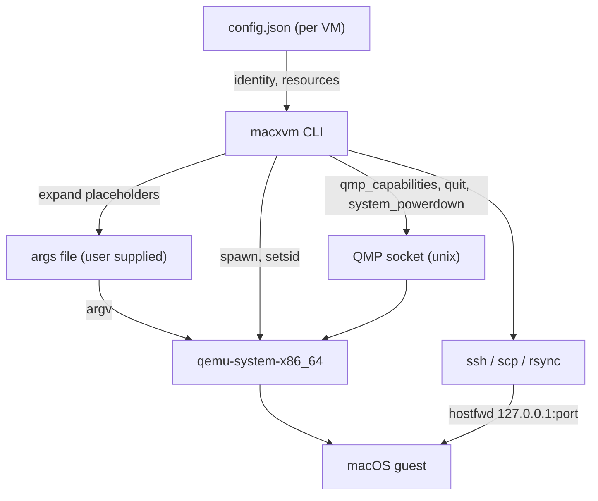

<div align="center">

# Architecture Specification - MacXVM

[](../CHANGELOG.md)
[](../LICENSE)


</div>

---

## Language

<a href="ARCHITECTURE.md">🇬🇧 English</a> · <a href="ARCHITECTURE_AR.md">🇸🇦 العربية</a>

---

## Table of Contents

- [Overview](#overview)
- [Packages](#packages)
- [Lifecycle](#lifecycle)
- [State Layout](#state-layout)
- [Command Flow](#command-flow)
- [Process Supervision](#process-supervision)
- [Networking](#networking)
- [Project Layout](#project-layout)
- [Design Rules](#design-rules)

---

<a id="overview"></a>
## Overview

MacXVM is a single static Go binary with no daemon. The only long-lived process is QEMU itself; MacXVM starts it, manages it over the QMP socket and exits. An idle host therefore carries no MacXVM process at all.

The Go code never describes a macOS machine. The reviewed default machine definition is data in `resources/args-template.txt`, with CPU models in `resources/cpu-models.txt`; MacXVM substitutes a handful of placeholders into it, appends its own management flags and starts QEMU with the result. A user may supply a different args file. This keeps every macOS-on-QEMU detail out of the Go source and ships no Apple binary.



<a id="packages"></a>
## Packages

| Package | Responsibility |
|---------|----------------|
| `cmd/macxvm` | Entry point, subcommand dispatch, panic recovery, exit codes |
| `internal/exitcode` | The error type that carries a CLI exit code |
| `internal/paths` | The state directory and the run directory |
| `internal/names` | The VM name rule and its validation |
| `internal/sizeparse` | Parsing of `--ram` values such as `4096`, `4096M`, `8G` |
| `internal/config` | The persisted description of a VM, atomic writes, identity generation |
| `internal/store` | Atomic registration, listing, cloning, resizing, sealing and deletion |
| `internal/argsfile` | Parsing, validation, expansion and required-file checks of the args file |
| `internal/bootstrap` | Non-secret resumable guest bootstrap and sudo verification |
| `internal/guestapps` | Fixed default allowlist, dry-run/manifest and selective removal |
| `internal/automation` | OCR-driven installer automation, seed ISO and setup detection |
| `internal/runstate` | Process detection through the pid file and `/proc`, the operation lock |
| `internal/qmp` | The minimal QEMU Machine Protocol client |
| `internal/qemu` | Preflight, process spawn, QMP socket path, readiness wait, argv assembly |
| `internal/sshx` | The argument builders for SSH, SCP and rsync, `ShellQuote`, the SSH wait |
| `internal/slim` | The slimming policy: the deny list, the label filter, the restore and the measurement |
| `internal/tools` | Command Line Tools, Homebrew and the tooling report |
| `internal/xcode` | Expansion and installation of Xcode inside the guest |
| `internal/project` | Detection of the project kind and the `macxvm.json` file |
| `internal/doctor` | The host checks and the legal notice |
| `internal/hostcheck` | Host facts (RAM, cores, disk, KVM) and the `Runner` seam for subprocesses |
| `internal/share` | The shared folder of the host and the guest, over rsync and SSH |
| `internal/image` | The boot assets of a macOS guest and the partition table of its disk |
| `internal/ui` | The mark of the project, the cards and the colours of the console |
| `internal/cmds` | One file per command, the flag splitter, the usage text |
| `resources` | The guest scripts and the launchd label list, embedded into the binary |

The dependency graph is acyclic and shallow. `paths`, `names`, `sizeparse`, `exitcode`, `hostcheck` and `qmp` are leaves and only use the standard library. `config` builds on `exitcode` and `paths`; `store` on `config`, `paths` and `hostcheck`; `qemu` on `config`, `paths`, `runstate` and `qmp`; `cmds` on everything else.

<a id="lifecycle"></a>
## Lifecycle

```
create ──► start ──► (slim, tools, xcode) ──► stop ──► base seal
              │                                     │
              │                                     ▼
              └──────────────► clone ───────────► overlay VM
                                                    │
                                              build / run
```

- `image prepare` verifies versioned assets and builds a GPT disk in staging, converts once to qcow2, checks it, then atomically publishes the VM. The default `cli` profile is 4 vCPUs / 8192 MiB / 64 GiB logical disk; `xcode` remains an explicit 4 / 8192 / 100 alternative.
- `create NAME --base BASE` clones a sealed base without reinstalling. Every VM gets an independent NVRAM copy. `--replace` replaces stopped VMs; `--force` only overrides resource limits.
- `autoinstall` drives OpenCore, Recovery Terminal, exact-size disk erase, license (explicit flag), target disk and Install, then waits for the first Setup Assistant page. It uses QMP screendumps plus OCR and vncdo pointer/keyboard input.
- `finish` resumes after the manual account/Remote Login steps: key, sudoers, Dark, power, slim level 1, Bochs display, app preview/removal, verification and optional seal.
- `base bootstrap` persists only non-secret stages `assets`, `install`, `manual-setup`, `ssh`, `verify`, `ready`. Manual Apple/license/account work stays in VNC.
- `start` spawns QEMU, reserves VNC under a global allocation lock, verifies QMP and the VNC listener, and records `created`, `qmp-ready`, `booting`, `ssh-ready`, `stopping`, `stopped` or `failed`. `start --wait` proves key-only SSH; `start --vnc`, `autoinstall` and `finish` open the viewer automatically (`--no-open` disables it); `open` never waits for SSH.
- `stop` tries bounded SSH only when trust already exists, then ACPI, QMP quit and finally a signal only after rechecking the exact QEMU marker. A live owned process is never reported as stopped.
- `base seal` requires a stopped bootstrap-ready VM. A sealed base is never booted; overlays cannot be resized or deleted out from under their dependents.
- `clone` creates an overlay of a sealed base after reloading the current config under `op.lock`, checking disk/NVRAM/args expansion and publishing atomically.
- `clone --full` converts the whole disk instead of copying the file, so that the copy is a standalone disk and does not need its base any more.
- `run` creates a throwaway overlay, runs one command in it and removes it afterwards, including when the command is interrupted.

<a id="state-layout"></a>
## State Layout

```
$MACXVM_HOME  (default: $XDG_DATA_HOME/macxvm, else ~/.local/share/macxvm)
├── id_ed25519, id_ed25519.pub     # the SSH key shared by every machine
    ├── assets/<macos>/<revision>/    # verified, versioned asset manifests
    ├── staging/                        # half-built machines, removed on failure
    └── vms/<name>/
    ├── config.json                 # the description of the machine
    ├── args.txt                    # a copy of the args file of the user
    ├── disk.qcow2                  # the disk, or an overlay of a base
    ├── nvram.fd                    # only with --nvram-template
    ├── qemu.pid                    # written by QEMU itself
    ├── console.log                 # the output of QEMU
    ├── op.lock                     # serialises start, stop, clone, seal, resize, delete
    ├── known_hosts                 # per-VM TOFU key, aliased to macxvm-<id>
    ├── bootstrap.json              # non-secret resumable bootstrap stages
    ├── apps-manifest.json          # removal results and recoverable KiB
    ├── apps-dry-run.json           # preview, never a removal record
    ├── apps-list.json              # listing, never a removal record
    └── slim-report.txt             # only after slim --measure

$MACXVM_RUN  (default: $XDG_RUNTIME_DIR/macxvm, else /tmp/macxvm-<uid>)
├── <id>.sock                       # the QMP socket of a machine
└── vnc.lock                        # global VNC allocation
```

The run directory holds an unauthenticated QMP socket. MacXVM therefore refuses to use it unless it is a real directory of the current user that no other user may write to.

<a id="command-flow"></a>
## Command Flow

Every command follows the same three steps:

1. **Parse and validate.** The name of the machine is validated before it is ever used to build a path. A name that does not match `^[a-z0-9][a-z0-9._-]{0,62}$` is refused with exit code 2.
2. **Take the operation lock.** `op.lock` is an exclusive, non-blocking `flock`. `start`, `stop`, `clone`, `seal` and `delete` hold it for the whole operation, so two commands can never work on the same machine at the same time.
3. **Work and report.** Errors are returned as `*exitcode.Error` and printed as `macxvm: error: <message>` on stderr. Data goes to stdout, progress goes to stderr.

The flags may be written before or after the name. A helper splits the leading positional out of the argument list before handing the rest to the `flag` package, so both `macxvm create NAME --assets DIR` and `macxvm create --assets DIR NAME` work.

<a id="process-supervision"></a>
## Process Supervision

QEMU is started with `Setsid`, so it outlives the command that started it and never receives a hangup from the terminal. The parent closes the process handle without waiting for it.

The state of a machine is derived from the pid file that QEMU writes, an exact QEMU marker search when the pid file is missing, and the persisted readiness state:

- `/proc/<pid>/stat` decides whether the process is gone or a zombie;
- `/proc/<pid>/cmdline` must contain the exact `guest=macxvm-<id>,process=macxvm-<id>` argument (or its process-only equivalent), preventing PID-reuse kills;
- the config is reloaded after `op.lock` and its stable VM ID is compared, so a stale operation cannot act on a replacement;
- VNC and QMP readiness are checked separately from SSH readiness. `open` uses the actual VNC listener, not a guessed port.

If a machine does not become QMP-ready within 20 seconds, the spawned QEMU is stopped, the pid file and socket are removed, and the command reports exit code 7. `start --wait` has a separate bounded SSH timeout. A QEMU that is still alive but lost its pid file is recognised through its marker, so it is never started a second time.

<a id="networking"></a>
## Networking

The guest is reached through the user-mode network stack of QEMU (SLIRP). MacXVM substitutes the placeholder `{{NETDEV}}` with:

```
user,id=net0,hostfwd=tcp:127.0.0.1:<port>-:22
```

The port is chosen when the machine is registered, stored in `config.json` and re-checked when the machine starts. If the port is taken in the meantime, a new free port is chosen and written back. This needs no root, no bridge and no IP discovery.

The port of a stopped machine is not reserved, so another local program may take it. SSH trust is therefore local TOFU only while the marked VM is running, and uses `HostKeyAlias=macxvm-<id>` in a per-VM `known_hosts`; a later port change does not change the VM identity. After the first trust, `StrictHostKeyChecking=yes` and `BatchMode=yes` are used. A mismatch fails instead of silently replacing the key. Readiness probes disable stale control masters and verify that QEMU is still alive.

<a id="project-layout"></a>
## Project Layout

```
macxvm/
├── cmd/macxvm/                    # the entry point of the binary
├── internal/                      # the packages of the tool
├── resources/                     # the guest scripts and the label list
├── scripts/                       # installation, benchmark, style checks
├── docs/                          # bilingual guides (EN + AR)
├── assets/logo/                   # the logo, the banner and the social preview
├── .github/                       # workflows, issue and pull request templates
├── Makefile                       # build, test, install, clean
├── CHANGELOG.md                   # the release notes
├── CONTRIBUTING.md                # how to contribute
├── CODE_OF_CONDUCT.md             # the rules of the community
├── SECURITY.md                    # how to report a vulnerability
└── README.md, README_AR.md        # the entry points
```

<a id="design-rules"></a>
## Design Rules

1. **The standard library only.** `go.mod` never gets a `require` line, `CGO_ENABLED=0` is always used and the binary stays static.
2. **No macOS on QEMU details in Go source.** The reviewed defaults are data resources, never constants in `.go` files.
3. **No Apple software in the repository.** No installer images, no boot loaders, no firmware, no keys. MacXVM launches the reviewed template or the args file the user provides.
4. **No placeholders.** No `TODO`, no `panic("not implemented")`, no commented out code, no fake output.
5. **Bounded slimming.** Only selected launchd labels and allowlisted applications are touched. Services/update policy can be restored; application removal is rolled back by cloning the sealed base, never by claiming to restore user data.
6. **Every subprocess is an argument vector.** `os/exec` never receives a shell command, and every value that comes from the user is quoted for the remote shell.
