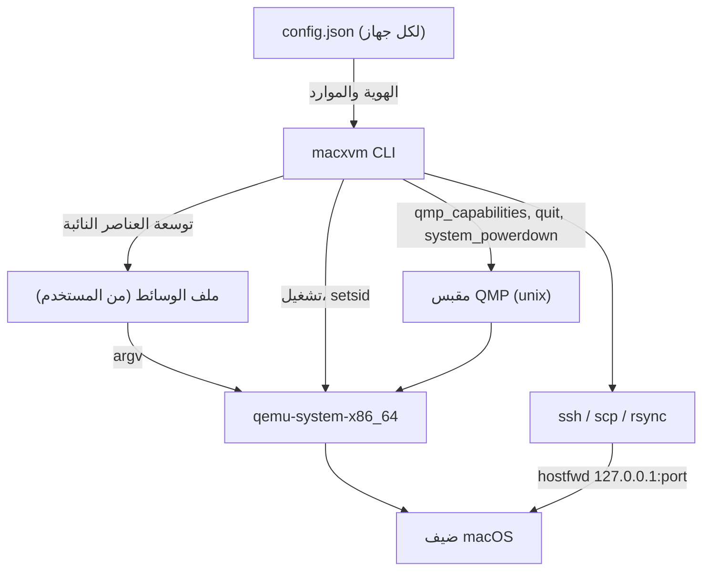

<div align="center">

# مواصفات البنية - MacXVM

[](../CHANGELOG.md)
[](../LICENSE)


</div>

---

## اللغة

<a href="ARCHITECTURE.md">🇬🇧 English</a> · <a href="ARCHITECTURE_AR.md">🇸🇦 العربية</a>

---

## فهرس المحتويات

- [نظرة عامة](#overview)
- [الحزم](#packages)
- [دورة الحياة](#lifecycle)
- [تخزين الحالة](#state-layout)
- [مسار الأوامر](#command-flow)
- [إدارة العملية](#process-supervision)
- [الشبكة](#networking)
- [تنظيم المشروع](#project-layout)
- [قواعد التصميم](#design-rules)

---

<a id="overview"></a>
## نظرة عامة

‏MacXVM ملف تنفيذي واحد ثابت مكتوب بلغة Go، بلا خادم دائم. العملية الوحيدة التي تبقى حية هي QEMU نفسها: يشغلها MacXVM، ويديرها عبر مقبس QMP، ثم يخرج. لذلك لا يحمل المضيف الخامل أي عملية من MacXVM إطلاقا.

الأداة لا تصف جهاز macOS أبدا. تعريف الجهاز يعيش في ملف وسائط (args file) يقدمه المستخدم: يستبدل MacXVM عددا قليلا من العناصر النائبة داخله، ويضيف أعلامه الخاصة، ويشغل QEMU بالنتيجة. هذا يبقي كل تفاصيل تشغيل macOS على QEMU (طراز المعالج، مفاتيح SMC، قيم SMBIOS، إعدادات OpenCore، مسارات البرنامج الثابت) خارج الشيفرة وخارج المستودع.



<a id="packages"></a>
## الحزم

| الحزمة | المسؤولية |
|--------|-----------|
| `cmd/macxvm` | نقطة الدخول، توزيع الأوامر الفرعية، التقاط الانهيارات، رموز الخروج |
| `internal/exitcode` | نوع الخطأ الذي يحمل رمز الخروج |
| `internal/paths` | مجلد الحالة ومجلد التشغيل |
| `internal/names` | قاعدة اسم الجهاز والتحقق منها |
| `internal/sizeparse` | تحليل قيم `--ram` مثل `4096` و`4096M` و`8G` |
| `internal/config` | وصف الجهاز المحفوظ، الكتابة الذرية، توليد الهوية |
| `internal/store` | تسجيل الأجهزة، عرضها، نسخها، ختمها، حذفها |
| `internal/argsfile` | تحليل ملف الوسائط والتحقق منه وتوسيعه |
| `internal/runstate` | كشف العملية عبر ملف المعرف و`/proc`، وقفل العمليات |
| `internal/qmp` | عميل بروتوكول QMP المصغر |
| `internal/qemu` | الفحص المسبق، تشغيل العملية، مسار مقبس QMP، انتظار الجاهزية |
| `internal/sshx` | بناة وسائط SSH وSCP وrsync، و`ShellQuote`، وانتظار SSH |
| `internal/slim` | سياسة التخفيف: قائمة المنع، ترشيح التسميات، الاستعادة والقياس |
| `internal/tools` | أدوات سطر الأوامر وHomebrew وتقرير الأدوات |
| `internal/xcode` | فك ضغط Xcode وتثبيته داخل الضيف |
| `internal/project` | كشف نوع المشروع وملف `macxvm.json` |
| `internal/doctor` | فحوص المضيف والتنبيه القانوني |
| `internal/hostcheck` | حقائق المضيف (الذاكرة، الأنوية، القرص، KVM) وواجهة `Runner` |
| `internal/share` | المجلد المشترك بين المضيف والضيف عبر rsync وSSH |
| `internal/image` | أصول إقلاع ضيف macOS وجدول تقسيم قرصه |
| `internal/ui` | علامة المشروع وبطاقات الكونسول وألوانه |
| `internal/cmds` | ملف واحد لكل أمر، وفاصل الأعلام، ونص الاستخدام |
| `resources` | سكربتات الضيف وقائمة تسميات launchd، مدمجة في الملف التنفيذي |

شجرة الاعتماديات بسيطة وبلا دورات. الحزم `paths` و`names` و`sizeparse` و`exitcode` و`hostcheck` و`qmp` أوراق تعتمد على المكتبة القياسية فقط. فوقها تأتي `config`، ثم `store`، ثم `qemu`، ثم `cmds` التي تجمع كل شيء.

<a id="lifecycle"></a>
## دورة الحياة

```
create ──► start ──► (slim, tools, xcode) ──► stop ──► base seal
              │                                     │
              │                                     ▼
              └──────────────► clone ───────────► جهاز طبقة
                                                    │
                                              build / run
```

- `create` يسجل الجهاز، وينشئ قرص qcow2 متفرقا، ويتحقق من ملف الوسائط، ويكتب `config.json`.
- `start` يشغل QEMU، وينتظر ملف المعرف ومقبس QMP، ثم ينفذ مصافحة QMP.
- `slim` و`tools` و`xcode` تعمل داخل الضيف عبر SSH. تشغل الجهاز إن كان متوقفا، وتوقفه مجددا فقط إن كانت هي التي شغلته.
- `base seal` يضع علامة على الجهاز كصورة أساس. الأساس الختم لا يشغل ولا يعدل أبدا، بل يستخدم كملف backing للطبقات.
- `clone` ينشئ طبقة فوق أساس ختم. الطبقة تكلف بضعة مئات كيلوبايت وتقلع في ثوان.
- `clone --full` يحول القرص كله بدل نسخ الملف، فيكون القرص مستقلا ولا يحتاج أساسه بعد الآن.
- `run` ينشئ طبقة مؤقتة، ينفذ أمرا واحدا فيها، ثم يحذفها، حتى عند مقاطعة الأمر.

<a id="state-layout"></a>
## تخزين الحالة

```
$MACXVM_HOME  (افتراضيا: $XDG_DATA_HOME/macxvm، وإلا ~/.local/share/macxvm)
├── id_ed25519, id_ed25519.pub     # مفتاح SSH المشترك بين كل الأجهزة
├── staging/                        # أجهزة قيد الإنشاء، تحذف عند الفشل
└── vms/<name>/
    ├── config.json                 # وصف الجهاز
    ├── args.txt                    # نسخة من ملف وسائط المستخدم
    ├── disk.qcow2                  # القرص، أو طبقة فوق أساس
    ├── nvram.fd                    # فقط مع ‎--nvram-template
    ├── qemu.pid                    # يكتبه QEMU نفسه
    ├── console.log                 # مخرجات QEMU
    ├── op.lock                     # يسلسل start وstop وclone وseal وdelete
    └── slim-report.txt             # فقط بعد slim --measure

$MACXVM_RUN  (افتراضيا: $XDG_RUNTIME_DIR/macxvm، وإلا /tmp/macxvm-<uid>)
└── <id>.sock                       # مقبس QMP الخاص بالجهاز
```

مجلد التشغيل يحتوي مقبس QMP بلا مصادقة، لذلك يرفض MacXVM用它 ما لم يكن مجلدا حقيقيا للمستخدم الحالي لا يستطيع غيره الكتابة فيه.

<a id="command-flow"></a>
## مسار الأوامر

كل أمر يمر بثلاث خطوات:

- ‏ **التحليل والتحقق.** اسم الجهاز يتحقق منه قبل أن يستخدم لبناء أي مسار. الاسم الذي لا يطابق `^[a-z0-9][a-z0-9._-]{0,62}$` يرفض برمز الخروج 2.
- ‏ **أخذ قفل العملية.** `op.lock` هو `flock` حصري غير حاجب. الأوامر `start` و`stop` و`clone` و`seal` و`delete` تحتفظ به طوال العملية، فلا يعمل أمران على الجهاز نفسه في الوقت نفسه.
- ‏ **العمل والإبلاغ.** الأخطاء تعاد ك `*exitcode.Error` وتطبع على stderr بصيغة `macxvm: error: <message>`. البيانات إلى stdout والتقدم إلى stderr.

يمكن كتابة الأعلام قبل الاسم أو بعده. helper يفصل العنصر الأول عن قائمة الوسائط قبل تسليم الباقي لحزمة `flag`، فيعمل `macxvm create NAME --assets DIR` و`macxvm create --assets DIR NAME` معا.

<a id="process-supervision"></a>
## إدارة العملية

يشغل QEMU مع `Setsid`، فيبقى حيا بعد خروج الأمر الذي شغله ولا يستقبل إشارة hangup من الطرفية. يغلق الوالد مقبض العملية دون انتظارها.

تشتق حالة الجهاز من ملف المعرف الذي يكتبه QEMU ومن سطر أوامر تلك العملية:

- تقرأ ملف المعرف ويحلل رقمها؛
- يقرر `/proc/<pid>/stat` ما إذا كانت العملية قد اختفت أو صارت زومبي؛
- يجب أن يحتوي `/proc/<pid>/cmdline` على `macxvm-<id>`، وهذا ما يجعل الفحص محصنا ضد إعادة استخدام أرقام العمليات.

لأن سطر أوامر العملية يكون فارغا لحظة بدءها، فإن قرار "هل خرج QEMU" يقوم على الحالة في `/proc/<pid>/stat` ولا يقوم على سطر الأوامر وحده.

إذا لم تصبح الجهاز جاهزا خلال 20 ثانية، يوقف QEMU المشغل، وتحذف ملف المعرف والمقبس، ويبلغ الأمر برمز الخروج 7. أما QEMU الذي ما زال حيا فقد فقد ملف المعرف فيعرف من سطر أوامره، فلا يشغل مرتين: عمليتا QEMU تكتبان صورة qcow2 واحدة تفسدها.

<a id="networking"></a>
## الشبكة

يوصل الضيف عبر مكدس الشبكة في وضع المستخدم (SLIRP) الخاص ب QEMU. يستبدل MacXVM العنصر `{{NETDEV}}` بالقيمة:

```
user,id=net0,hostfwd=tcp:127.0.0.1:<port>-:22
```

يختار المنفذ عند تسجيل الجهاز، ويحفظ في `config.json`، ويعاد فحصه عند الإقلاع. إن كان مشغولا في تلك الأثناء، يختار منفذ حر جديد ويكتب من جديد. لا حاجة لصلاحيات root ولا جسور ولا اكتشاف عناوين IP.

منفذ الجهاز المتوقف غير محجوز، فقد يأخذه برنامج محلي آخر. لهذا تستخدم اتصالات SSH مهلة اتصال قصيرة وخيارات إبقاء حي: برنامج يرد على المنفذ يجب أن لا يستطيع تعليق MacXVM.

<a id="project-layout"></a>
## تنظيم المشروع

```
macxvm/
├── cmd/macxvm/                    # نقطة الدخول للملف التنفيذي
├── internal/                      # حزم الأداة
├── resources/                     # سكربتات الضيف وقائمة التسميات
├── scripts/                       # التثبيت والقياس وفحص النمط
├── docs/                          # أدلة ثنائية اللغة (إنجليزي + عربي)
├── assets/logo/                   # الشعار واللافتة ومعاينة التواصل
├── .github/                       # مسارات العمل وقوالب Issues وPull Requests
├── Makefile                       # build وtest وinstall وclean
├── CHANGELOG.md                   # ملاحظات الإصدارات
├── CONTRIBUTING.md                # كيف تساهم
├── CODE_OF_CONDUCT.md             # قواعد المجتمع
├── SECURITY.md                    # كيف تبلغ عن ثغرة
└── README.md, README_AR.md        # نقطتا الدخول
```

<a id="design-rules"></a>
## قواعد التصميم

- ‏ **المكتبة القياسية فقط.** لا يدخل `go.mod` أي سطر `require`، ويستخدم `CGO_ENABLED=0` دائما فيبقى الملف التنفيذي ثابتا.
- ‏ **لا تفاصيل macOS على QEMU داخل الشيفرة.** لا طراز معالج، ولا مفاتيح SMC أو OSK، ولا قيم SMBIOS، ولا إعدادات OpenCore، ولا مسارات البرامج الثابتة.
- ‏ **لا برمجيات Apple داخل المستودع.** لا صور تثبيت، ولا محملات إقلاع، ولا برامج ثابتة، ولا مفاتيح. MacXVM يشغل ما يقدمه المستخدم.
- ‏ **لا عناصر نائبة.** لا `TODO`، ولا `panic("not implemented")`، ولا شيفرة معطلة، ولا مخرجات وهمية.
- ‏ **تخفيف قابل للعكس.** لا تمس إلا تسميات launchd الموجودة في ملف التسميات، وقائمة المنع تحمي SSH والشبكة، وكل تغيير قابل للتراجع.
- ‏ **كل عملية فرعية متجه وسائط.** لا تتلقى `os/exec` أبدا أمر shell، وكل قيمة تأتي من المستخدم تقتبس لصدفة الضيف البعيدة.
