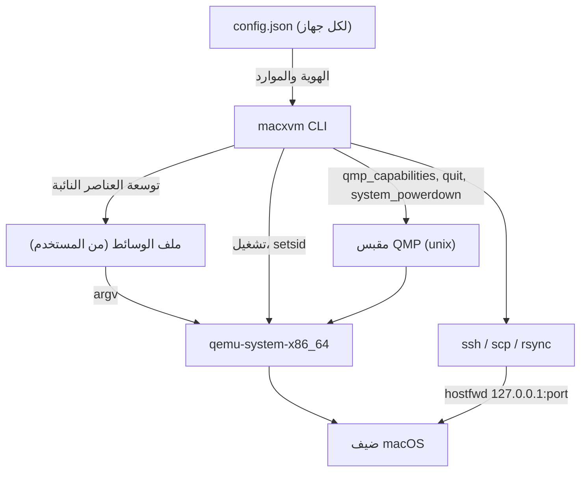

<div align="center">

# مواصفات البنية - MacXVM

[](../CHANGELOG.md)
[](../LICENSE)


</div>

---

## اللغة

<a href="ARCHITECTURE.md">🇬🇧 English</a> · <a href="ARCHITECTURE_AR.md">🇸🇦 العربية</a>

---

## فهرس المحتويات

- [نظرة عامة](#overview)
- [الحزم](#packages)
- [دورة الحياة](#lifecycle)
- [تخزين الحالة](#state-layout)
- [مسار الأوامر](#command-flow)
- [إدارة العملية](#process-supervision)
- [الشبكة](#networking)
- [تنظيم المشروع](#project-layout)
- [قواعد التصميم](#design-rules)

---

<a id="overview"></a>
## نظرة عامة

‏MacXVM ملف تنفيذي واحد ثابت مكتوب بلغة Go، بلا خادم دائم. العملية الوحيدة التي تبقى حية هي QEMU نفسها: يشغلها MacXVM، ويديرها عبر مقبس QMP، ثم يخرج. لذلك لا يحمل المضيف الخامل أي عملية من MacXVM إطلاقا.

شيفرة Go لا تصف جهاز macOS أبدا. تعريف الجهاز الافتراضي المراجَع بيانات في `resources/args-template.txt`، ونماذج المعالج في `resources/cpu-models.txt`: يستبدل MacXVM العناصر النائبة داخله، ويضيف أعلامه الخاصة، ويشغل QEMU بالنتيجة. ويمكن للمستخدم تقديم ملف وسائط مختلف. هذا يبقي تفاصيل macOS على QEMU خارج شيفرة Go، ولا يوزع المستودع أي برنامج من Apple.



<a id="packages"></a>
## الحزم

| الحزمة | المسؤولية |
|--------|-----------|
| `cmd/macxvm` | نقطة الدخول، توزيع الأوامر الفرعية، التقاط الانهيارات، رموز الخروج |
| `internal/exitcode` | نوع الخطأ الذي يحمل رمز الخروج |
| `internal/paths` | مجلد الحالة ومجلد التشغيل |
| `internal/names` | قاعدة اسم الجهاز والتحقق منها |
| `internal/sizeparse` | تحليل قيم `--ram` مثل `4096` و`4096M` و`8G` |
| `internal/config` | وصف الجهاز المحفوظ، الكتابة الذرية، توليد الهوية |
| `internal/store` | تسجيل ذري، عرض، نسخ، resize، ختم وحذف الأجهزة |
| `internal/argsfile` | تحليل ملف الوسائط والتحقق منه وتوسيعه وفحص ملفاته المطلوبة |
| `internal/bootstrap` | bootstrap غير سري قابل للاستئناف والتحقق من sudo |
| `internal/guestapps` | allowlist افتراضية ثابتة، dry-run/manifest وحذف انتقائي |
| `internal/automation` | أتمتة المثبت عبر OCR وseed ISO واكتشاف Setup |
| `internal/runstate` | كشف العملية عبر ملف المعرف و`/proc`، وقفل العمليات |
| `internal/qmp` | عميل بروتوكول QMP المصغر |
| `internal/qemu` | الفحص المسبق، تشغيل العملية، مسار مقبس QMP، انتظار الجاهزية |
| `internal/sshx` | بناة وسائط SSH وSCP وrsync، و`ShellQuote`، وانتظار SSH |
| `internal/slim` | سياسة التخفيف: قائمة المنع، ترشيح التسميات، الاستعادة والقياس |
| `internal/tools` | أدوات سطر الأوامر وHomebrew وتقرير الأدوات |
| `internal/xcode` | فك ضغط Xcode وتثبيته داخل الضيف |
| `internal/project` | كشف نوع المشروع وملف `macxvm.json` |
| `internal/doctor` | فحوص المضيف والتنبيه القانوني |
| `internal/hostcheck` | حقائق المضيف (الذاكرة، الأنوية، القرص، KVM) وواجهة `Runner` |
| `internal/share` | المجلد المشترك بين المضيف والضيف عبر rsync وSSH |
| `internal/image` | أصول إقلاع ضيف macOS وجدول تقسيم قرصه |
| `internal/ui` | علامة المشروع وبطاقات الكونسول وألوانه |
| `internal/cmds` | ملف واحد لكل أمر، وفاصل الأعلام، ونص الاستخدام |
| `resources` | سكربتات الضيف وقائمة تسميات launchd، مدمجة في الملف التنفيذي |

شجرة الاعتماديات بسيطة وبلا دورات. الحزم `paths` و`names` و`sizeparse` و`exitcode` و`hostcheck` و`qmp` أوراق تعتمد على المكتبة القياسية فقط. فوقها تأتي `config`، ثم `store`، ثم `qemu`، ثم `cmds` التي تجمع كل شيء.

<a id="lifecycle"></a>
## دورة الحياة

```
create ──► start ──► (slim, tools, xcode) ──► stop ──► base seal
              │                                     │
              │                                     ▼
              └──────────────► clone ───────────► جهاز طبقة
                                                    │
                                              build / run
```

- `image prepare` يتحقق من أصول مفصولة حسب الإصدار، ويبني GPT في staging، ويحول مرة واحدة إلى qcow2، ويفحصه ثم ينشر ذريًا. `cli` افتراضيًا 4 vCPU / 8192 MiB / 64 GiB منطقية، و`xcode` بديل صريح 4 / 8192 / 100.
- `create NAME --base BASE` يستنسخ أساسًا مختومًا دون إعادة تثبيت، ولكل VM نسخة NVRAM مستقلة. `--replace` يستبدل جهازًا متوقفًا، و`--force` لتجاوز حدود الموارد التجريبية فقط.
- `autoinstall` يقود OpenCore ثم Recovery Terminal ثم مسح القرص المطابق ثم الترخيص (بعلم صريح) ثم القرص ثم Install، وينتظر أول صفحة Setup Assistant. يستخدم QMP screendump مع OCR وvncdo للإدخال.
- `finish` يستأنف بعد الحساب وRemote Login اليدويين: المفتاح وsudoers وDark والطاقة وslim level 1 وعرض Bochs ومعاينة التطبيقات والحذف الاختياري والتحقق والختم الاختياري.
- `base bootstrap` يحفظ مراحل غير سرية فقط: `assets` و`install` و`manual-setup` و`ssh` و`verify` و`ready`. خطوات ترخيص Apple والحساب تبقى يدوية في VNC.
- `start` يشغل QEMU ويحجز VNC تحت قفل عام، ويتحقق من QMP ومن مستمع VNC، ويسجل `created` أو `qmp-ready` أو `booting` أو `ssh-ready` أو `stopping` أو `stopped` أو `failed`. و`start --wait` يثبت SSH بالمفتاح، و`open` لا ينتظر SSH.
- `stop` يحاول SSH المحدود فقط عند وجود ثقة سابقة، ثم ACPI، ثم QMP quit، ثم إشارة بعد إعادة فحص marker QEMU الدقيق. لا يعلن نجاح الإيقاف وعملية مملوكة ما زالت حية.
- `base seal` يتطلب جهازًا متوقفًا اجتاز bootstrap. الأساس المختوم لا يقلع، ولا تحذف أو تعدل طبقاته من تحته.
- `clone` ينشئ طبقة بعد إعادة تحميل config الحالي تحت `op.lock`، وفحص القرص وNVRAM وقابلية توسيع args، ثم ينشر ذريًا.
- `clone --full` يحول القرص كله بدل نسخ الملف، فيكون القرص مستقلا ولا يحتاج أساسه بعد الآن.
- `run` ينشئ طبقة مؤقتة، ينفذ أمرا واحدا فيها، ثم يحذفها، حتى عند مقاطعة الأمر.

<a id="state-layout"></a>
## تخزين الحالة

```
$MACXVM_HOME  (افتراضيا: $XDG_DATA_HOME/macxvm، وإلا ~/.local/share/macxvm)
├── assets/<macos>/<revision>/    # أصول موثقة بmanifest مفصولة حسب الإصدار
├── id_ed25519, id_ed25519.pub     # مفتاح SSH المشترك بين كل الأجهزة
├── staging/                        # أجهزة قيد الإنشاء، تحذف عند الفشل
└── vms/<name>/
    ├── config.json                 # وصف الجهاز
    ├── args.txt                    # نسخة من ملف وسائط المستخدم
    ├── disk.qcow2                  # القرص، أو طبقة فوق أساس
    ├── nvram.fd                    # نسخة NVRAM المستقلة
    ├── known_hosts                 # TOFU لكل VM باسم macxvm-<id>
    ├── bootstrap.json              # مراحل bootstrap غير السرية
    ├── apps-manifest.json          # نتائج الحذف والمساحة القابلة للاستعادة
    ├── apps-dry-run.json           # معاينة لا تُعد سجل حذف
    ├── apps-list.json              # عرض لا يُعد سجل حذف
    ├── qemu.pid                    # يكتبه QEMU نفسه
    ├── console.log                 # مخرجات QEMU
    ├── op.lock                     # يسلسل start وstop وclone وseal وresize وdelete
    └── slim-report.txt             # فقط بعد slim --measure

$MACXVM_RUN  (افتراضيا: $XDG_RUNTIME_DIR/macxvm، وإلا /tmp/macxvm-<uid>)
├── <id>.sock                       # مقبس QMP الخاص بالجهاز
└── vnc.lock                        # حجز VNC العام
```

مجلد التشغيل يحتوي مقبس QMP بلا مصادقة، لذلك يرفض MacXVM استخدامه ما لم يكن مجلدا حقيقيا للمستخدم الحالي لا يستطيع غيره الكتابة فيه.

<a id="command-flow"></a>
## مسار الأوامر

كل أمر يمر بثلاث خطوات:

- ‏ **التحليل والتحقق.** اسم الجهاز يتحقق منه قبل أن يستخدم لبناء أي مسار. الاسم الذي لا يطابق `^[a-z0-9][a-z0-9._-]{0,62}$` يرفض برمز الخروج 2.
- ‏ **أخذ قفل العملية.** `op.lock` هو `flock` حصري غير حاجب. الأوامر `start` و`stop` و`clone` و`seal` و`delete` تحتفظ به طوال العملية، فلا يعمل أمران على الجهاز نفسه في الوقت نفسه.
- ‏ **العمل والإبلاغ.** الأخطاء تعاد ك `*exitcode.Error` وتطبع على stderr بصيغة `macxvm: error: <message>`. البيانات إلى stdout والتقدم إلى stderr.

يمكن كتابة الأعلام قبل الاسم أو بعده. helper يفصل العنصر الأول عن قائمة الوسائط قبل تسليم الباقي لحزمة `flag`، فيعمل `macxvm create NAME --assets DIR` و`macxvm create --assets DIR NAME` معا.

<a id="process-supervision"></a>
## إدارة العملية

يشغل QEMU مع `Setsid`، فيبقى حيا بعد خروج الأمر الذي شغله ولا يستقبل إشارة hangup من الطرفية. يغلق الوالد مقبض العملية دون انتظارها.

تشتق الحالة من ملف المعرف، ومن بحث دقيق عن marker QEMU عند غياب الملف، ومن حالة الجاهزية المحفوظة:

- يقرر `/proc/<pid>/stat` ما إذا كانت العملية اختفت أو صارت زومبي؛
- يجب أن يحتوي `/proc/<pid>/cmdline` على الوسيط الدقيق `guest=macxvm-<id>,process=macxvm-<id>`، فلا يمكن قتل عملية أعيد استخدام PID الخاص بها؛
- يعاد تحميل config بعد `op.lock` وتقارن هوية VM، فلا تعمل عملية قديمة على بديل جديد؛
- جاهزية VNC وQMP منفصلة عن جاهزية SSH. `open` يستخدم مستمع VNC الفعلي لا منفذًا مخمنًا.

إذا لم يصبح QMP جاهزًا خلال 20 ثانية، يوقف QEMU المشغل وتحذف الملفات ويبلغ رمز الخروج 7. ل`start --wait` مهلة SSH منفصلة. وQEMU الحي الذي فقد pidfile يعرف من marker، فلا يشغل مرتين.

<a id="networking"></a>
## الشبكة

يوصل الضيف عبر مكدس الشبكة في وضع المستخدم (SLIRP) الخاص ب QEMU. يستبدل MacXVM العنصر `{{NETDEV}}` بالقيمة:

```
user,id=net0,hostfwd=tcp:127.0.0.1:<port>-:22
```

يختار المنفذ عند تسجيل الجهاز، ويحفظ في `config.json`، ويعاد فحصه عند الإقلاع. إن كان مشغولا في تلك الأثناء، يختار منفذ حر جديد ويكتب من جديد. لا حاجة لصلاحيات root ولا جسور ولا اكتشاف عناوين IP.

منفذ الجهاز المتوقف غير محجوز، فقد يأخذه برنامج محلي آخر. لذلك تكون ثقة SSH محلية TOFU فقط أثناء عمل VM المملوكة، وتستخدم `HostKeyAlias=macxvm-<id>` في `known_hosts` مستقل؛ تغيير المنفذ لا يغير هوية الجهاز. بعد الثقة يستخدم `StrictHostKeyChecking=yes` و`BatchMode=yes`، وأي اختلاف مفتاح يفشل بدل استبداله. فحوص الجاهزية تعطل control master القديم وتتحقق من أن QEMU ما زال حيًا.

<a id="project-layout"></a>
## تنظيم المشروع

```
macxvm/
├── cmd/macxvm/                    # نقطة الدخول للملف التنفيذي
├── internal/                      # حزم الأداة
├── resources/                     # سكربتات الضيف وقائمة التسميات
├── scripts/                       # التثبيت والقياس وفحص النمط
├── docs/                          # أدلة ثنائية اللغة (إنجليزي + عربي)
├── assets/logo/                   # الشعار واللافتة ومعاينة التواصل
├── .github/                       # مسارات العمل وقوالب Issues وPull Requests
├── Makefile                       # build وtest وinstall وclean
├── CHANGELOG.md                   # ملاحظات الإصدارات
├── CONTRIBUTING.md                # كيف تساهم
├── CODE_OF_CONDUCT.md             # قواعد المجتمع
├── SECURITY.md                    # كيف تبلغ عن ثغرة
└── README.md, README_AR.md        # نقطتا الدخول
```

<a id="design-rules"></a>
## قواعد التصميم

- ‏ **المكتبة القياسية فقط.** لا يدخل `go.mod` أي سطر `require`، ويستخدم `CGO_ENABLED=0` دائما فيبقى الملف التنفيذي ثابتا.
- ‏ **لا تفاصيل macOS على QEMU داخل شيفرة Go.** القيم الافتراضية المراجَعة موارد بيانات، وليست ثوابت في ملفات `.go`.
- ‏ **لا برمجيات Apple داخل المستودع.** لا صور تثبيت، ولا محملات إقلاع، ولا برامج ثابتة، ولا مفاتيح. MacXVM يشغل القالب المراجَع أو ملف الوسائط الذي يقدمه المستخدم.
- ‏ **لا عناصر نائبة.** لا `TODO`، ولا `panic("not implemented")`، ولا شيفرة معطلة، ولا مخرجات وهمية.
- ‏ **تخفيف قابل للعكس.** لا تمس إلا تسميات launchd الموجودة في ملف التسميات، وقائمة المنع تحمي SSH والشبكة، وكل تغيير قابل للتراجع.
- ‏ **كل عملية فرعية متجه وسائط.** لا تتلقى `os/exec` أبدا أمر shell، وكل قيمة تأتي من المستخدم تقتبس لصدفة الضيف البعيدة.
